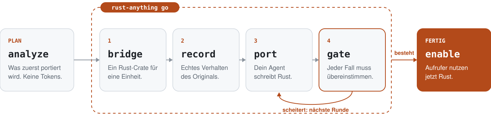

<p align="center">
  <a href="https://rustanything.ai/">
    
  </a>
</p>

<h1 align="center">Rust Anything</h1>

<p align="center">
<a href="https://crates.io/crates/rust-anything"></a>
<a href="https://www.npmjs.com/package/rust-anything"></a>
<a href="https://github.com/erkamyaman/rust-anything/stargazers"></a>
<a href="https://discord.gg/FXhUEA8eBR"></a>
<a href="https://github.com/erkamyaman/rust-anything#license"></a><br>
<a href="https://rustanything.ai/"></a>
<a href="https://crates.io/crates/rust-anything"></a>
<a href="https://www.npmjs.com/package/rust-anything"></a>
</p>

<p align="center">
Schreibe deine App in Rust neu und beweise, dass sie sich weiterhin genauso verhält.
</p>

<p align="center">
<a href="https://trendshift.io/repositories/363468" target="_blank" rel="noopener noreferrer"></a>
<a href="https://trendshift.io/repositories/363468" target="_blank" rel="noopener noreferrer"></a>
</p>

<p align="center"><b>Dokumentation:</b> <a href="https://rustanything.ai/de">https://rustanything.ai/de</a></p>

<p align="center"><a href="translations.md">🌐 Andere Sprachen</a></p>

<p align="center">Du überträgst eine Codebasis nach Rust? Ich biete Beratung für Rust-Migrationen an: <a href="mailto:hello@rustanything.ai">hello@rustanything.ai</a></p>

<p align="center"><sub>Diese Übersetzung wird von der Community gepflegt und kann hinter dem <a href="../README.md">englischen README</a> zurückliegen.</sub></p>

## Sponsoren

<p align="center">Made in Türkiye 🇹🇷 von <a href="https://github.com/erkamyaman">erKam Yaman</a><br>
Rust Anything ist kostenlos und Open Source. Wenn es dir bei der Arbeit hilft, hält dein Sponsoring es am Laufen.</p>

<p align="center">
  <a href="https://coderabbit.link/er-kam">
    <picture>
      <source media="(prefers-color-scheme: dark)" srcset="assets/sponsors/company-dark.svg">
      
    </picture>
  </a>
</p>

<p align="center">
  <a href="https://www.atakdomain.com/">
    <picture>
      <source media="(prefers-color-scheme: dark)" srcset="assets/sponsors/domain-dark.svg">
      
    </picture>
  </a>
</p>

<p align="center">
  <a href="https://github.com/sponsors/erkamyaman">
    <picture>
      <source media="(prefers-color-scheme: dark)" srcset="assets/sponsors/sponsors-dark.svg">
      
    </picture>
  </a>
</p>

<p align="center">
  <a href="https://github.com/sponsors/erkamyaman"></a>
  <a href="https://buymeacoffee.com/erkamyaman"></a>
</p>

<p align="center">Sponsoring als Unternehmen oder etwas anderes? <a href="mailto:hello@rustanything.ai">hello@rustanything.ai</a></p>

<p align="center">Du überträgst eine Codebasis nach Rust? Ich biete Beratung für Rust-Migrationen an: <a href="mailto:hello@rustanything.ai">hello@rustanything.ai</a></p>

## Schnellstart

Füge das in deinen Coding-Agenten ein:

```text
Install Rust Anything with npm i -g rust-anything, then run rust-anything setup. Run rust-anything go -- <slow command of this app> and finish the port until rust-anything gate passes.
```

Oder installiere es selbst:

```sh
cargo install rust-anything   # or: npm install -g rust-anything
rust-anything setup           # adds it to Claude Code, Codex, Cursor, Gemini CLI and OpenCode
```

> [!TIP]
> **Agenten:** Lies [rustanything.ai/llms.txt](https://rustanything.ai/llms.txt) für die Installationsschritte, alle Befehle und den Portierungsablauf.

## So funktioniert es

<p align="center">
  <picture>
    <source media="(prefers-color-scheme: dark)" srcset="assets/how-it-works/de-dark.svg">
    
  </picture>
</p>

**Was als fertig gilt.** Das Verhalten, nicht deine Tests. `record` führt das Original mit generierten und vorgegebenen Eingaben aus und speichert, was jeder Aufruf zurückgibt, wirft und ausgibt. Eine Portierung ist fertig, wenn `gate` besteht: Jeder aufgezeichnete Fall stimmt überein, und fmt, clippy, `cargo test`, die `unsafe`-Prüfung, die Stub-Prüfung und die Prüfung auf aufgezeichnete Antworten, die in die Portierung kopiert wurden, bestehen alle. Deine eigenen Tests laufen ebenfalls.

**Bericht oder Migration, du entscheidest.** `analyze` und `profile` berichten nur: ein priorisierter Plan, was portiert werden sollte, und was unter echter Last heiß ist. Es sind normale Befehle, der Bericht kostet also keine Tokens. `go` migriert eine Einheit: Es baut eine Brücke zur heißesten Funktion, zeichnet sie auf, übergibt die Portierung an deinen Agenten, kompiliert und vergleicht sie dann, lässt `gate` laufen und schaltet sie erst ein, wenn alles übereinstimmt (TS/JS, Python und PowerShell; `disable` schaltet sie wieder ab).

**Wie lange ein Lauf dauert.** Ein `go`-Lauf portiert eine Einheit, mit höchstens `--rounds` Agentenrunden (standardmäßig 3): eine für die Portierung, dann eine pro fehlgeschlagenem Diff oder Gate. Eine ganze App ist ein Lauf pro Einheit, du kannst also nach jedem aufhören.

**Günstiges Modell für den Plan, starkes Modell für die Portierung.** Der Plan braucht kein Modell. Für die Portierung übergib einen beliebigen Agentenbefehl: `rust-anything go --agent "claude --model <model>" -- <workload>`.

**Agenten.** `rust-anything setup` fügt es zu Claude Code, Codex, Cursor, Gemini CLI und OpenCode hinzu. Jeder andere MCP-Client kann `rust-anything mcp` ausführen, und der Skill lässt sich auch eigenständig mit `npx skills add erkamyaman/rust-anything` installieren (siehe [Installation](install.md)).

## Lizenz

[MIT](../LICENSE-MIT) / [Apache-2.0](../LICENSE-APACHE) © [Erkam Yaman](https://github.com/erkamyaman). Portierungen und generierter Code in
deinem Repository gehören dir.
