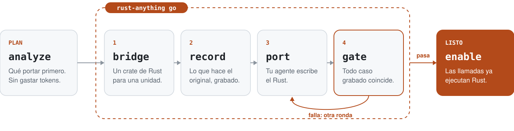

<p align="center">
  <a href="https://rustanything.ai/">
    
  </a>
</p>

<h1 align="center">Rust Anything</h1>

<p align="center">
<a href="https://crates.io/crates/rust-anything"></a>
<a href="https://www.npmjs.com/package/rust-anything"></a>
<a href="https://github.com/erkamyaman/rust-anything/stargazers"></a>
<a href="https://discord.gg/FXhUEA8eBR"></a>
<a href="https://github.com/erkamyaman/rust-anything#license"></a><br>
<a href="https://rustanything.ai/"></a>
<a href="https://crates.io/crates/rust-anything"></a>
<a href="https://www.npmjs.com/package/rust-anything"></a>
</p>

<p align="center">
Reescribe tu aplicación en Rust y demuestra que sigue comportándose igual.
</p>

<p align="center">
<a href="https://trendshift.io/repositories/363468" target="_blank" rel="noopener noreferrer"></a>
<a href="https://trendshift.io/repositories/363468" target="_blank" rel="noopener noreferrer"></a>
</p>

<p align="center"><b>Documentación:</b> <a href="https://rustanything.ai/es">https://rustanything.ai/es</a></p>

<p align="center"><a href="translations.md">🌐 Otros idiomas</a></p>

<p align="center">¿Migrando una base de código a Rust? Ofrezco consultoría para migraciones a Rust: <a href="mailto:hello@rustanything.ai">hello@rustanything.ai</a></p>

<p align="center"><sub>Esta traducción la mantiene la comunidad y puede quedarse atrás respecto al <a href="../README.md">README en inglés</a>.</sub></p>

## Patrocinadores

<p align="center">Hecho en Türkiye 🇹🇷 por <a href="https://github.com/erkamyaman">erKam Yaman</a><br>
Rust Anything es gratuito y de código abierto. Si te ayuda en tu trabajo, tu patrocinio lo mantiene en marcha.</p>

<p align="center">
  <a href="https://coderabbit.link/er-kam">
    <picture>
      <source media="(prefers-color-scheme: dark)" srcset="assets/sponsors/company-dark.svg">
      
    </picture>
  </a>
</p>

<p align="center">
  <a href="https://www.atakdomain.com/">
    <picture>
      <source media="(prefers-color-scheme: dark)" srcset="assets/sponsors/domain-dark.svg">
      
    </picture>
  </a>
</p>

<p align="center">
  <a href="https://github.com/sponsors/erkamyaman">
    <picture>
      <source media="(prefers-color-scheme: dark)" srcset="assets/sponsors/sponsors-dark.svg">
      
    </picture>
  </a>
</p>

<p align="center">
  <a href="https://github.com/sponsors/erkamyaman"></a>
  <a href="https://buymeacoffee.com/erkamyaman"></a>
</p>

<p align="center">¿Patrocinio como empresa, o cualquier otra cosa? <a href="mailto:hello@rustanything.ai">hello@rustanything.ai</a></p>

<p align="center">¿Migrando una base de código a Rust? Ofrezco consultoría para migraciones a Rust: <a href="mailto:hello@rustanything.ai">hello@rustanything.ai</a></p>

## Inicio rápido

Pega esto en tu agente de código:

```text
Install Rust Anything with npm i -g rust-anything, then run rust-anything setup. Run rust-anything go -- <slow command of this app> and finish the port until rust-anything gate passes.
```

O instálalo tú mismo:

```sh
cargo install rust-anything   # or: npm install -g rust-anything
rust-anything setup           # adds it to Claude Code, Codex, Cursor, Gemini CLI and OpenCode
```

> [!TIP]
> **Agentes:** lee [rustanything.ai/llms.txt](https://rustanything.ai/llms.txt) para los pasos de instalación, todos los comandos y el flujo de migración.

## Cómo funciona

<p align="center">
  <picture>
    <source media="(prefers-color-scheme: dark)" srcset="assets/how-it-works/es-dark.svg">
    
  </picture>
</p>

**Qué cuenta como terminado.** El comportamiento, no tus tests. `record` ejecuta el original con entradas generadas y dadas, y guarda lo que cada llamada devuelve, lanza e imprime. Un porte está terminado cuando `gate` pasa: todos los casos grabados coinciden, y fmt, clippy, `cargo test`, la comprobación de `unsafe`, la de stubs y la de respuestas grabadas pegadas en el porte pasan todas. Tus propios tests también se ejecutan.

**Informe o migración, tú eliges.** `analyze` y `profile` solo informan: un plan ordenado de qué portar y de qué está caliente bajo una carga real. Son comandos normales, así que el informe no cuesta tokens. `go` migra una unidad: crea el puente para la función más caliente, la graba, entrega el porte a tu agente, luego lo compila, lo compara y lo pasa por `gate`, y solo lo activa cuando todo coincide (TS/JS, Python y PowerShell; `disable` lo vuelve a desactivar).

**Cuánto dura una ejecución.** Una ejecución de `go` porta una unidad, con como máximo `--rounds` turnos del agente (3 por defecto): uno para el porte y luego uno por cada diff o gate que falle. Una aplicación entera es una ejecución por unidad, así que puedes parar después de cualquiera.

**Modelo barato para el plan, modelo potente para el porte.** El plan no necesita modelo. Para el porte, pasa cualquier comando de agente: `rust-anything go --agent "claude --model <model>" -- <workload>`.

**Agentes.** `rust-anything setup` lo añade a Claude Code, Codex, Cursor, Gemini CLI y OpenCode. Cualquier otro cliente MCP puede ejecutar `rust-anything mcp`, y la skill también se instala por sí sola con `npx skills add erkamyaman/rust-anything` (ver [instalación](install.md)).

## Licencia

[MIT](../LICENSE-MIT) / [Apache-2.0](../LICENSE-APACHE) © [Erkam Yaman](https://github.com/erkamyaman). Los portes y el código generado en tu repositorio son tuyos.
