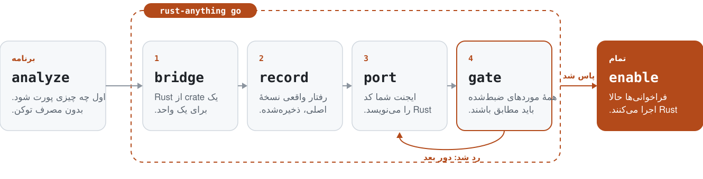

<p align="center">
  <a href="https://rustanything.ai/">
    
  </a>
</p>

<h1 align="center">Rust Anything</h1>

<p align="center">
<a href="https://crates.io/crates/rust-anything"></a>
<a href="https://www.npmjs.com/package/rust-anything"></a>
<a href="https://github.com/erkamyaman/rust-anything/stargazers"></a>
<a href="https://discord.gg/FXhUEA8eBR"></a>
<a href="https://github.com/erkamyaman/rust-anything#license"></a><br>
<a href="https://crates.io/crates/rust-anything"></a>
<a href="https://www.npmjs.com/package/rust-anything"></a>
</p>

<div dir="rtl">

<p align="center">
برنامه‌تان را به Rust بازنویسی کنید و ثابت کنید که هنوز دقیقاً مثل قبل رفتار می‌کند.
</p>

<p align="center">
<a href="https://trendshift.io/repositories/363468" target="_blank" rel="noopener noreferrer"></a>
<a href="https://trendshift.io/repositories/363468" target="_blank" rel="noopener noreferrer"></a>
</p>

<p align="center"><b>مستندات:</b> <a href="https://rustanything.ai/fa">https://rustanything.ai/fa</a></p>

<p align="center"><a href="translations.md">🌐 زبان‌های دیگر</a></p>

<p align="center">کدبیس‌تان را به Rust منتقل می‌کنید؟ برای مهاجرت به Rust مشاوره می‌دهم: <a href="mailto:hello@rustanything.ai">hello@rustanything.ai</a></p>

<p align="center"><sub>این ترجمه را جامعه نگهداری می‌کند و ممکن است از <a href="../README.md">README انگلیسی</a> عقب بماند.</sub></p>

## حامیان

<p align="center">ساخت Türkiye 🇹🇷، توسط <a href="https://github.com/erkamyaman">erKam Yaman</a><br>
Rust Anything رایگان و متن‌باز است. اگر به کارتان می‌آید، حمایت مالی شما آن را پیش می‌برد.</p>

<p align="center">
  <a href="https://coderabbit.link/er-kam">
    <picture>
      <source media="(prefers-color-scheme: dark)" srcset="assets/sponsors/company-dark.svg">
      
    </picture>
  </a>
</p>

<p align="center">
  <a href="https://www.atakdomain.com/">
    <picture>
      <source media="(prefers-color-scheme: dark)" srcset="assets/sponsors/domain-dark.svg">
      
    </picture>
  </a>
</p>

<p align="center">
  <a href="https://github.com/sponsors/erkamyaman">
    <picture>
      <source media="(prefers-color-scheme: dark)" srcset="assets/sponsors/sponsors-dark.svg">
      
    </picture>
  </a>
</p>

<p align="center">
  <a href="https://github.com/sponsors/erkamyaman"></a>
  <a href="https://buymeacoffee.com/erkamyaman"></a>
</p>

<p align="center">حمایت مالی به‌عنوان شرکت، یا هر موضوع دیگری؟ <a href="mailto:hello@rustanything.ai">hello@rustanything.ai</a></p>

<p align="center">کدبیس‌تان را به Rust منتقل می‌کنید؟ برای مهاجرت به Rust مشاوره می‌دهم: <a href="mailto:hello@rustanything.ai">hello@rustanything.ai</a></p>

## شروع سریع

این را در ایجنت برنامه‌نویسی خود بچسبانید:

```text
Install Rust Anything with npm i -g rust-anything, then run rust-anything setup. Run rust-anything go -- <slow command of this app> and finish the port until rust-anything gate passes.
```

یا خودتان نصبش کنید:

```sh
cargo install rust-anything   # or: npm install -g rust-anything
rust-anything setup           # adds it to Claude Code, Codex, Cursor, Gemini CLI and OpenCode
```

> **ایجنت‌ها:** برای مراحل نصب، همهٔ دستورها و روند پورت، [rustanything.ai/llms.txt](https://rustanything.ai/llms.txt) را بخوانید.

## چطور کار می‌کند

<p align="center">
  <picture>
    <source media="(prefers-color-scheme: dark)" srcset="assets/how-it-works/fa-dark.svg">
    
  </picture>
</p>

**چه چیزی تمام‌شده حساب می‌شود.** رفتار، نه تست‌های شما. `record` نسخهٔ اصلی را روی ورودی‌های تولیدشده و داده‌شده اجرا می‌کند و آنچه هر فراخوانی برمی‌گرداند، پرتاب می‌کند و چاپ می‌کند را ذخیره می‌کند. پورت وقتی تمام است که `gate` پاس شود: همهٔ موردهای ضبط‌شده مطابقت دارند، و fmt، clippy، `cargo test`، بررسی `unsafe`، بررسی stub و بررسی پاسخ‌های ضبط‌شده‌ای که در پورت چسبانده شده‌اند همگی پاس می‌شوند. تست‌های خودتان هم اجرا می‌شوند.

**گزارش یا مهاجرت، انتخاب با شماست.** `analyze` و `profile` فقط گزارش می‌دهند: یک برنامهٔ رتبه‌بندی‌شده از اینکه چه چیزی را پورت کنید، و اینکه زیر بار کاری واقعی چه بخشی داغ است. این‌ها دستورهای ساده‌اند، پس گزارش هیچ توکنی مصرف نمی‌کند. `go` یک واحد را مهاجرت می‌دهد: برای داغ‌ترین تابع پل می‌سازد، آن را ضبط می‌کند، پورت را به ایجنت شما می‌سپارد، سپس آن را build می‌کند، diff می‌گیرد و از `gate` می‌گذراند، و فقط وقتی همه چیز مطابقت داشت آن را روشن می‌کند (TS/JS، Python و PowerShell؛ `disable` دوباره خاموشش می‌کند).

**هر اجرا چقدر طول می‌کشد.** هر اجرای `go` یک واحد را پورت می‌کند، با حداکثر `--rounds` نوبت ایجنت (پیش‌فرض 3): یکی برای پورت، سپس یکی به ازای هر diff یا gate ناموفق. کل برنامه یعنی یک اجرا برای هر واحد، پس می‌توانید بعد از هر کدام متوقف شوید.

**مدل ارزان برای برنامه، مدل قوی برای پورت.** برنامه به مدل نیازی ندارد. برای پورت، هر دستور ایجنتی را بدهید: `rust-anything go --agent "claude --model <model>" -- <workload>`.

**ایجنت‌ها.** `rust-anything setup` آن را به Claude Code، Codex، Cursor، Gemini CLI و OpenCode اضافه می‌کند. هر کلاینت MCP دیگری می‌تواند `rust-anything mcp` را اجرا کند، و اسکیل هم به‌تنهایی با `npx skills add erkamyaman/rust-anything` نصب می‌شود ([نصب](install.md) را ببینید).

## مجوز

[MIT](../LICENSE-MIT) / [Apache-2.0](../LICENSE-APACHE) © [Erkam Yaman](https://github.com/erkamyaman). انتقال‌ها و کد تولیدشده در
مخزن شما متعلق به شماست.

</div>
