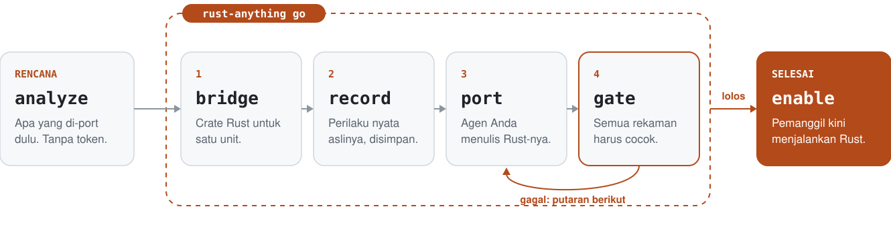

<p align="center">
  <a href="https://rustanything.ai/">
    
  </a>
</p>

<h1 align="center">Rust Anything</h1>

<p align="center">
<a href="https://crates.io/crates/rust-anything"></a>
<a href="https://www.npmjs.com/package/rust-anything"></a>
<a href="https://github.com/erkamyaman/rust-anything/stargazers"></a>
<a href="https://discord.gg/FXhUEA8eBR"></a>
<a href="https://github.com/erkamyaman/rust-anything#license"></a><br>
<a href="https://crates.io/crates/rust-anything"></a>
<a href="https://www.npmjs.com/package/rust-anything"></a>
</p>

<p align="center">
Tulis ulang aplikasi Anda dalam Rust, dan buktikan perilakunya tetap sama.
</p>

<p align="center">
<a href="https://trendshift.io/repositories/363468" target="_blank" rel="noopener noreferrer"></a>
<a href="https://trendshift.io/repositories/363468" target="_blank" rel="noopener noreferrer"></a>
</p>

<p align="center"><b>Dokumentasi:</b> <a href="https://rustanything.ai/id">https://rustanything.ai/id</a></p>

<p align="center"><a href="translations.md">🌐 Bahasa lain</a></p>

<p align="center">Memindahkan codebase ke Rust? Saya menawarkan konsultasi untuk migrasi ke Rust: <a href="mailto:hello@rustanything.ai">hello@rustanything.ai</a></p>

<p align="center"><sub>Terjemahan ini dikelola oleh komunitas dan bisa tertinggal dari <a href="../README.md">README berbahasa Inggris</a>.</sub></p>

## Sponsor

<p align="center">Dibuat di Türkiye 🇹🇷 oleh <a href="https://github.com/erkamyaman">erKam Yaman</a><br>
Rust Anything gratis dan open source. Jika membantu pekerjaan Anda, sponsor Anda membuatnya terus berjalan.</p>

<p align="center"><sub>Keamanan Anda yang utama: sponsor mendapat logo dan tautan di sini, tidak lebih. Tidak ada rekomendasi berbayar dan tidak ada panduan setup untuk reseller API AI pihak ketiga, jadi tidak ada apa pun di sini yang mengarahkan kode, key, atau data Anda ke tempat yang tidak Anda pilih.</sub></p>

<p align="center">
  <a href="https://coderabbit.link/er-kam">
    <picture>
      <source media="(prefers-color-scheme: dark)" srcset="assets/sponsors/company-dark.svg">
      
    </picture>
  </a>
</p>

<p align="center">
  <a href="https://www.atakdomain.com/">
    <picture>
      <source media="(prefers-color-scheme: dark)" srcset="assets/sponsors/domain-dark.svg">
      
    </picture>
  </a>
</p>

<p align="center">
  <a href="https://github.com/sponsors/erkamyaman">
    <picture>
      <source media="(prefers-color-scheme: dark)" srcset="assets/sponsors/sponsors-dark.svg">
      
    </picture>
  </a>
</p>

<p align="center">
  <a href="https://github.com/sponsors/erkamyaman"></a>
  <a href="https://buymeacoffee.com/erkamyaman"></a>
</p>

<p align="center">Sponsor sebagai perusahaan, atau hal lain? <a href="mailto:hello@rustanything.ai">hello@rustanything.ai</a></p>

<p align="center">Memindahkan codebase ke Rust? Saya menawarkan konsultasi untuk migrasi ke Rust: <a href="mailto:hello@rustanything.ai">hello@rustanything.ai</a></p>

## Mulai cepat

Tempel ini ke agen coding Anda:

```text
Install Rust Anything with npm i -g rust-anything, then run rust-anything setup. Run rust-anything go -- <slow command of this app> and finish the port until rust-anything gate passes.
```

Atau pasang sendiri:

```sh
cargo install rust-anything   # or: npm install -g rust-anything
rust-anything setup           # adds it to Claude Code, Codex, Cursor, Gemini CLI and OpenCode
```

> [!TIP]
> **Agen:** baca [rustanything.ai/llms.txt](https://rustanything.ai/llms.txt) untuk langkah instalasi, semua perintah, dan alur porting.

## Cara kerjanya

<p align="center">
  <picture>
    <source media="(prefers-color-scheme: dark)" srcset="assets/how-it-works/id-dark.svg">
    
  </picture>
</p>

**Apa yang dianggap selesai.** Perilaku, bukan tes Anda. `record` menjalankan versi asli dengan input yang dihasilkan dan yang diberikan, lalu menyimpan apa yang dikembalikan, dilempar, dan dicetak setiap panggilan. Port selesai saat `gate` lolos: setiap kasus yang direkam cocok, dan fmt, clippy, `cargo test`, pemeriksaan `unsafe`, pemeriksaan stub, serta pemeriksaan jawaban rekaman yang ditempel ke port semuanya lolos. Tes Anda sendiri juga dijalankan.

**Laporan atau migrasi, Anda yang pilih.** `analyze` dan `profile` hanya melapor: rencana berperingkat tentang apa yang perlu di-port, dan bagian mana yang panas di bawah beban kerja nyata. Keduanya perintah biasa, jadi laporannya tidak memakan token. `go` memigrasikan satu unit: membuat jembatan untuk fungsi terpanas, merekamnya, menyerahkan port ke agen Anda, lalu mem-build, membandingkan, dan menjalankan `gate` padanya, dan baru mengaktifkannya saat semuanya cocok (TS/JS, Python, dan PowerShell; `disable` mematikannya kembali).

**Berapa lama satu run.** Satu run `go` mem-port satu unit, dengan paling banyak `--rounds` giliran agen (default 3): satu untuk port, lalu satu per diff atau gate yang gagal. Seluruh aplikasi berarti satu run per unit, jadi Anda bisa berhenti setelah yang mana pun.

**Model murah untuk rencana, model kuat untuk port.** Rencana tidak butuh model. Untuk port, berikan perintah agen apa pun: `rust-anything go --agent "claude --model <model>" -- <workload>`.

**Agen.** `rust-anything setup` menambahkannya ke Claude Code, Codex, Cursor, Gemini CLI, dan OpenCode. Klien MCP lain bisa menjalankan `rust-anything mcp`, dan skill-nya juga bisa dipasang sendiri dengan `npx skills add erkamyaman/rust-anything` (lihat [instalasi](install.md)).

## Lisensi

[MIT](../LICENSE-MIT) / [Apache-2.0](../LICENSE-APACHE) © [Erkam Yaman](https://github.com/erkamyaman). Port dan kode yang dihasilkan di repositori Anda adalah milik Anda.
