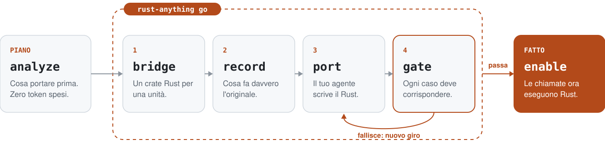

<p align="center">
  <a href="https://rustanything.ai/">
    
  </a>
</p>

<h1 align="center">Rust Anything</h1>

<p align="center">
<a href="https://crates.io/crates/rust-anything"></a>
<a href="https://www.npmjs.com/package/rust-anything"></a>
<a href="https://github.com/erkamyaman/rust-anything/stargazers"></a>
<a href="https://discord.gg/FXhUEA8eBR"></a>
<a href="https://github.com/erkamyaman/rust-anything#license"></a><br>
<a href="https://crates.io/crates/rust-anything"></a>
<a href="https://www.npmjs.com/package/rust-anything"></a>
</p>

<p align="center">
Riscrivi la tua applicazione in Rust e dimostra che si comporta ancora allo stesso modo.
</p>

<p align="center">
<a href="https://trendshift.io/repositories/363468" target="_blank" rel="noopener noreferrer"></a>
<a href="https://trendshift.io/repositories/363468" target="_blank" rel="noopener noreferrer"></a>
</p>

<p align="center"><b>Documentazione:</b> <a href="https://rustanything.ai/it">https://rustanything.ai/it</a></p>

<p align="center"><a href="translations.md">🌐 Altre lingue</a></p>

<p align="center">Stai portando una codebase in Rust? Offro consulenza per le migrazioni a Rust: <a href="mailto:hello@rustanything.ai">hello@rustanything.ai</a></p>

<p align="center"><sub>Questa traduzione è mantenuta dalla community e può restare indietro rispetto al <a href="../README.md">README in inglese</a>.</sub></p>

## Sponsor

<p align="center">Fatto in Türkiye 🇹🇷 da <a href="https://github.com/erkamyaman">erKam Yaman</a><br>
Rust Anything è gratuito e open source. Se ti aiuta nel lavoro, la tua sponsorizzazione lo fa andare avanti.</p>

<p align="center">
  <a href="https://coderabbit.link/er-kam">
    <picture>
      <source media="(prefers-color-scheme: dark)" srcset="assets/sponsors/company-dark.svg">
      
    </picture>
  </a>
</p>

<p align="center">
  <a href="https://www.atakdomain.com/">
    <picture>
      <source media="(prefers-color-scheme: dark)" srcset="assets/sponsors/domain-dark.svg">
      
    </picture>
  </a>
</p>

<p align="center">
  <a href="https://github.com/sponsors/erkamyaman">
    <picture>
      <source media="(prefers-color-scheme: dark)" srcset="assets/sponsors/sponsors-dark.svg">
      
    </picture>
  </a>
</p>

<p align="center">
  <a href="https://github.com/sponsors/erkamyaman"></a>
  <a href="https://buymeacoffee.com/erkamyaman"></a>
</p>

<p align="center">Sponsorizzazione come azienda, o qualcos'altro? <a href="mailto:hello@rustanything.ai">hello@rustanything.ai</a></p>

<p align="center">Stai portando una codebase in Rust? Offro consulenza per le migrazioni a Rust: <a href="mailto:hello@rustanything.ai">hello@rustanything.ai</a></p>

## Avvio rapido

Incolla questo nel tuo agente di programmazione:

```text
Install Rust Anything with npm i -g rust-anything, then run rust-anything setup. Run rust-anything go -- <slow command of this app> and finish the port until rust-anything gate passes.
```

Oppure installalo tu:

```sh
cargo install rust-anything   # or: npm install -g rust-anything
rust-anything setup           # adds it to Claude Code, Codex, Cursor, Gemini CLI and OpenCode
```

> [!TIP]
> **Agenti:** leggete [rustanything.ai/llms.txt](https://rustanything.ai/llms.txt) per i passi di installazione, tutti i comandi e il flusso di porting.

## Come funziona

<p align="center">
  <picture>
    <source media="(prefers-color-scheme: dark)" srcset="assets/how-it-works/it-dark.svg">
    
  </picture>
</p>

**Cosa conta come finito.** Il comportamento, non i tuoi test. `record` esegue l'originale su input generati e forniti e salva ciò che ogni chiamata restituisce, lancia e stampa. Un port è finito quando `gate` passa: ogni caso registrato corrisponde, e fmt, clippy, `cargo test`, il controllo `unsafe`, il controllo degli stub e quello sulle risposte registrate incollate nel port passano tutti. Girano anche i tuoi test.

**Report o migrazione, scegli tu.** `analyze` e `profile` si limitano a riferire: un piano ordinato di cosa portare e di cosa è caldo sotto un carico reale. Sono comandi normali, quindi il report non costa token. `go` migra un'unità: crea il ponte verso la funzione più calda, la registra, passa il port al tuo agente, poi lo compila, lo confronta e lo fa passare da `gate`, e lo attiva solo quando tutto corrisponde (TS/JS, Python e PowerShell; `disable` lo disattiva di nuovo).

**Quanto dura un'esecuzione.** Un'esecuzione di `go` porta un'unità, con al massimo `--rounds` turni dell'agente (3 di default): uno per il port, poi uno per ogni diff o gate fallito. Un'intera applicazione è un'esecuzione per unità, quindi puoi fermarti dopo una qualsiasi.

**Modello economico per il piano, modello potente per il port.** Il piano non richiede alcun modello. Per il port, passa un qualsiasi comando di agente: `rust-anything go --agent "claude --model <model>" -- <workload>`.

**Agenti.** `rust-anything setup` lo aggiunge a Claude Code, Codex, Cursor, Gemini CLI e OpenCode. Qualsiasi altro client MCP può eseguire `rust-anything mcp`, e la skill si installa anche da sola con `npx skills add erkamyaman/rust-anything` (vedi [installazione](install.md)).

## Licenza

[MIT](../LICENSE-MIT) / [Apache-2.0](../LICENSE-APACHE) © [Erkam Yaman](https://github.com/erkamyaman). I port e il codice generato nel tuo repository sono tuoi.
