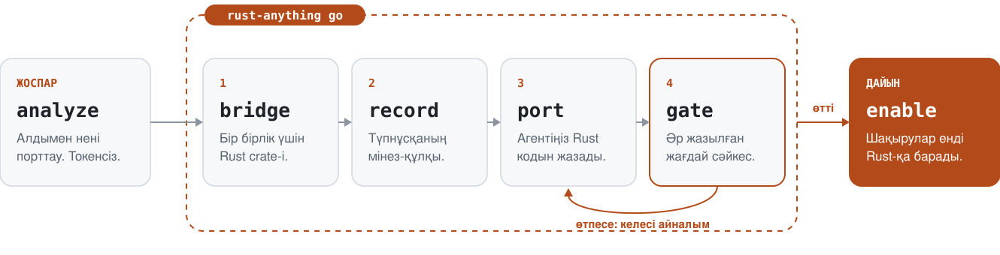

<p align="center">
  <a href="https://rustanything.ai/">
    
  </a>
</p>

<h1 align="center">Rust Anything</h1>

<p align="center">
<a href="https://crates.io/crates/rust-anything"></a>
<a href="https://www.npmjs.com/package/rust-anything"></a>
<a href="https://github.com/erkamyaman/rust-anything/stargazers"></a>
<a href="https://discord.gg/FXhUEA8eBR"></a>
<a href="https://github.com/erkamyaman/rust-anything#license"></a><br>
<a href="https://crates.io/crates/rust-anything"></a>
<a href="https://www.npmjs.com/package/rust-anything"></a>
</p>

<p align="center">
Қолданбаңызды Rust тілінде қайта жазып, оның бұрынғыдай жұмыс істейтінін дәлелдеңіз.
</p>

<p align="center">
<a href="https://trendshift.io/repositories/363468" target="_blank" rel="noopener noreferrer"></a>
<a href="https://trendshift.io/repositories/363468" target="_blank" rel="noopener noreferrer"></a>
</p>

<p align="center"><b>Құжаттама:</b> <a href="https://rustanything.ai/kk">https://rustanything.ai/kk</a></p>

<p align="center"><a href="translations.md">🌐 Басқа тілдер</a></p>

<p align="center">Код базаңызды Rust-қа көшіріп жатырсыз ба? Rust-қа көшу бойынша кеңес беремін: <a href="mailto:hello@rustanything.ai">hello@rustanything.ai</a></p>

<p align="center"><sub>Бұл аударманы қауымдастық жүргізеді, сондықтан ол <a href="../README.md">ағылшынша README</a> нұсқасынан артта қалуы мүмкін.</sub></p>

## Демеушілер

<p align="center">Türkiye 🇹🇷 елінде <a href="https://github.com/erkamyaman">erKam Yaman</a> жасаған<br>
Rust Anything тегін әрі ашық бастапқы кодты. Жұмысыңызға пайдасы тисе, демеушілігіңіз оны алға жылжытады.</p>

<p align="center">
  <a href="https://coderabbit.link/er-kam">
    <picture>
      <source media="(prefers-color-scheme: dark)" srcset="assets/sponsors/company-dark.svg">
      
    </picture>
  </a>
</p>

<p align="center">
  <a href="https://www.atakdomain.com/">
    <picture>
      <source media="(prefers-color-scheme: dark)" srcset="assets/sponsors/domain-dark.svg">
      
    </picture>
  </a>
</p>

<p align="center">
  <a href="https://github.com/sponsors/erkamyaman">
    <picture>
      <source media="(prefers-color-scheme: dark)" srcset="assets/sponsors/sponsors-dark.svg">
      
    </picture>
  </a>
</p>

<p align="center">
  <a href="https://github.com/sponsors/erkamyaman"></a>
  <a href="https://buymeacoffee.com/erkamyaman"></a>
</p>

<p align="center">Компания ретінде демеушілік пе, әлде басқа нәрсе ме? <a href="mailto:hello@rustanything.ai">hello@rustanything.ai</a></p>

<p align="center">Код базаңызды Rust-қа көшіріп жатырсыз ба? Rust-қа көшу бойынша кеңес беремін: <a href="mailto:hello@rustanything.ai">hello@rustanything.ai</a></p>

## Жылдам бастау

Мұны код жазатын агентіңізге қойыңыз:

```text
Install Rust Anything with npm i -g rust-anything, then run rust-anything setup. Run rust-anything go -- <slow command of this app> and finish the port until rust-anything gate passes.
```

Немесе өзіңіз орнатыңыз:

```sh
cargo install rust-anything   # or: npm install -g rust-anything
rust-anything setup           # adds it to Claude Code, Codex, Cursor, Gemini CLI and OpenCode
```

> [!TIP]
> **Агенттерге:** орнату қадамдары, барлық командалар және порттау тәртібі үшін [rustanything.ai/llms.txt](https://rustanything.ai/llms.txt) оқыңыз.

## Бұл қалай жұмыс істейді

<p align="center">
  <picture>
    <source media="(prefers-color-scheme: dark)" srcset="assets/how-it-works/kk-dark.svg">
    
  </picture>
</p>

**Не дайын деп саналады.** Сіздің тесттеріңіз емес, мінез-құлық. `record` түпнұсқаны генерацияланған және берілген кіріс деректерімен іске қосып, әр шақырудың нені қайтаратынын, лақтыратынын және шығаратынын сақтайды. Порт `gate` өткенде дайын: жазылған әр жағдай сәйкес келеді, сондай-ақ fmt, clippy, `cargo test`, `unsafe` тексерісі, stub тексерісі және портқа қойылған жазылған жауаптарды тексеру де өтеді. Өз тесттеріңіз де іске қосылады.

**Есеп пе, көшіру ме, өзіңіз таңдайсыз.** `analyze` және `profile` тек есеп береді: нені порттау керектігінің реттелген жоспары және нақты жүктеме кезінде не ең көп уақыт алатыны. Бұлар қарапайым командалар, сондықтан есеп ешқандай токен жұмсамайды. `go` бір бірлікті көшіреді: ең қызу функцияға көпір жасайды, оны жазады, портты агентіңізге береді, содан кейін құрастырады, салыстырады және `gate` арқылы өткізеді, бәрі сәйкес келгенде ғана қосады (TS/JS, Python және PowerShell; `disable` қайта өшіреді).

**Бір іске қосу қанша уақыт алады.** Бір `go` іске қосуы бір бірлікті порттайды, ең көбі `--rounds` агент айналымымен (әдепкі бойынша 3): біреуі порт үшін, содан кейін әр сәтсіз diff немесе gate үшін біреуден. Бүкіл қолданба әр бірлікке бір іске қосудан тұрады, сондықтан кез келгенінен кейін тоқтай аласыз.

**Жоспарға арзан модель, портқа күшті модель.** Жоспарға модель керек емес. Порт үшін кез келген агент командасын беріңіз: `rust-anything go --agent "claude --model <model>" -- <workload>`.

**Агенттер.** `rust-anything setup` оны Claude Code, Codex, Cursor, Gemini CLI және OpenCode-қа қосады. Кез келген басқа MCP клиенті `rust-anything mcp` іске қоса алады, ал skill `npx skills add erkamyaman/rust-anything` арқылы бөлек те орнатылады ([орнату](install.md) бөлімін қараңыз).

## Лицензия

[MIT](../LICENSE-MIT) / [Apache-2.0](../LICENSE-APACHE) © [Erkam Yaman](https://github.com/erkamyaman). Репозиторийіңіздегі порттар мен генерацияланған код сіздікі.
