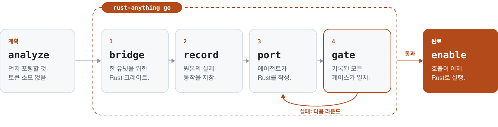

<p align="center">
  <a href="https://rustanything.ai/">
    
  </a>
</p>

<h1 align="center">Rust Anything</h1>

<p align="center">
<a href="https://crates.io/crates/rust-anything"></a>
<a href="https://www.npmjs.com/package/rust-anything"></a>
<a href="https://github.com/erkamyaman/rust-anything/stargazers"></a>
<a href="https://discord.gg/FXhUEA8eBR"></a>
<a href="https://github.com/erkamyaman/rust-anything#license"></a><br>
<a href="https://crates.io/crates/rust-anything"></a>
<a href="https://www.npmjs.com/package/rust-anything"></a>
</p>

<p align="center">
앱을 Rust로 다시 작성하고, 여전히 똑같이 동작함을 증명하세요.
</p>

<p align="center">
<a href="https://trendshift.io/repositories/363468" target="_blank" rel="noopener noreferrer"></a>
<a href="https://trendshift.io/repositories/363468" target="_blank" rel="noopener noreferrer"></a>
</p>

<p align="center"><b>문서:</b> <a href="https://rustanything.ai/ko">https://rustanything.ai/ko</a></p>

<p align="center"><a href="translations.md">🌐 다른 언어</a></p>

<p align="center">코드베이스를 Rust로 옮기시나요? Rust 마이그레이션 컨설팅을 제공합니다: <a href="mailto:hello@rustanything.ai">hello@rustanything.ai</a></p>

<p align="center"><sub>이 번역은 커뮤니티에서 관리하며 <a href="../README.md">영어 README</a>보다 늦게 반영될 수 있습니다.</sub></p>

## 후원자

<p align="center">Türkiye 🇹🇷에서 <a href="https://github.com/erkamyaman">erKam Yaman</a>가 만들었습니다<br>
Rust Anything은 무료 오픈 소스입니다. 작업에 도움이 된다면, 후원이 개발을 이어 가게 합니다.</p>

<p align="center">
  <a href="https://coderabbit.link/er-kam">
    <picture>
      <source media="(prefers-color-scheme: dark)" srcset="assets/sponsors/company-dark.svg">
      
    </picture>
  </a>
</p>

<p align="center">
  <a href="https://www.atakdomain.com/">
    <picture>
      <source media="(prefers-color-scheme: dark)" srcset="assets/sponsors/domain-dark.svg">
      
    </picture>
  </a>
</p>

<p align="center">
  <a href="https://github.com/sponsors/erkamyaman">
    <picture>
      <source media="(prefers-color-scheme: dark)" srcset="assets/sponsors/sponsors-dark.svg">
      
    </picture>
  </a>
</p>

<p align="center">
  <a href="https://github.com/sponsors/erkamyaman"></a>
  <a href="https://buymeacoffee.com/erkamyaman"></a>
</p>

<p align="center">기업 후원이나 그 밖의 문의가 있으신가요? <a href="mailto:hello@rustanything.ai">hello@rustanything.ai</a></p>

<p align="center">코드베이스를 Rust로 옮기시나요? Rust 마이그레이션 컨설팅을 제공합니다: <a href="mailto:hello@rustanything.ai">hello@rustanything.ai</a></p>

## 빠른 시작

이것을 코딩 에이전트에 붙여 넣으세요:

```text
Install Rust Anything with npm i -g rust-anything, then run rust-anything setup. Run rust-anything go -- <slow command of this app> and finish the port until rust-anything gate passes.
```

또는 직접 설치하세요:

```sh
cargo install rust-anything   # or: npm install -g rust-anything
rust-anything setup           # adds it to Claude Code, Codex, Cursor, Gemini CLI and OpenCode
```

> [!TIP]
> **에이전트:** 설치 단계, 모든 명령, 포팅 흐름은 [rustanything.ai/llms.txt](https://rustanything.ai/llms.txt)를 읽으세요.

## 작동 방식

<p align="center">
  <picture>
    <source media="(prefers-color-scheme: dark)" srcset="assets/how-it-works/ko-dark.svg">
    
  </picture>
</p>

**무엇이 완료인가.** 여러분의 테스트가 아니라 동작입니다. `record`는 생성된 입력과 주어진 입력으로 원본을 실행하고, 각 호출이 반환하고 던지고 출력하는 것을 저장합니다. `gate`가 통과하면 포팅이 완료됩니다: 기록된 모든 케이스가 일치하고, fmt, clippy, `cargo test`, `unsafe` 검사, 스텁 검사, 기록된 답을 포팅 코드에 붙여 넣었는지 보는 검사가 모두 통과해야 합니다. 여러분의 테스트도 함께 실행됩니다.

**보고서 또는 마이그레이션, 선택은 여러분의 몫.** `analyze`와 `profile`은 보고만 합니다: 무엇을 포팅할지 순위를 매긴 계획과, 실제 워크로드에서 무엇이 뜨거운지. 일반 명령이므로 보고서에는 토큰이 들지 않습니다. `go`는 한 유닛을 마이그레이션합니다: 가장 뜨거운 함수를 브리지하고, 기록하고, 포팅을 에이전트에 넘긴 뒤, 빌드하고 diff로 비교하고 `gate`를 실행하며, 모든 것이 일치할 때만 켭니다 (TS/JS, Python, PowerShell; `disable`로 다시 끌 수 있습니다).

**한 번 실행에 걸리는 시간.** `go`를 한 번 실행하면 한 유닛을 포팅하며, 에이전트 턴은 최대 `--rounds`번(기본값 3)입니다: 포팅에 한 번, 그 뒤 실패한 diff나 gate마다 한 번. 앱 전체는 유닛마다 한 번씩 실행하므로, 어느 실행 뒤에든 멈출 수 있습니다.

**계획에는 저렴한 모델, 포팅에는 강한 모델.** 계획에는 모델이 필요 없습니다. 포팅에는 아무 에이전트 명령이나 넘기세요: `rust-anything go --agent "claude --model <model>" -- <workload>`.

**에이전트.** `rust-anything setup`은 Claude Code, Codex, Cursor, Gemini CLI, OpenCode에 추가합니다. 다른 MCP 클라이언트는 `rust-anything mcp`를 실행할 수 있고, 스킬은 `npx skills add erkamyaman/rust-anything`로 따로 설치할 수도 있습니다([설치](install.md) 참고).

## 라이선스

[MIT](../LICENSE-MIT) / [Apache-2.0](../LICENSE-APACHE) © [Erkam Yaman](https://github.com/erkamyaman). 저장소 내 포팅 결과물과 생성된 코드는 여러분의 것입니다.
