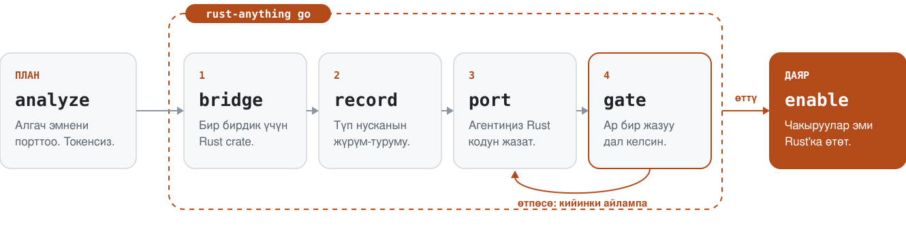

<p align="center">
  <a href="https://rustanything.ai/">
    
  </a>
</p>

<h1 align="center">Rust Anything</h1>

<p align="center">
<a href="https://crates.io/crates/rust-anything"></a>
<a href="https://www.npmjs.com/package/rust-anything"></a>
<a href="https://github.com/erkamyaman/rust-anything/stargazers"></a>
<a href="https://discord.gg/FXhUEA8eBR"></a>
<a href="https://github.com/erkamyaman/rust-anything#license"></a><br>
<a href="https://rustanything.ai/"></a>
<a href="https://crates.io/crates/rust-anything"></a>
<a href="https://www.npmjs.com/package/rust-anything"></a>
</p>

<p align="center">
Колдонмоңузду Rust тилинде кайра жазып, анын мурункудай иштээрин далилдеңиз.
</p>

<p align="center">
<a href="https://trendshift.io/repositories/363468" target="_blank" rel="noopener noreferrer"></a>
<a href="https://trendshift.io/repositories/363468" target="_blank" rel="noopener noreferrer"></a>
</p>

<p align="center"><b>Документация:</b> <a href="https://rustanything.ai/ky">https://rustanything.ai/ky</a></p>

<p align="center"><a href="translations.md">🌐 Башка тилдер</a></p>

<p align="center">Код базаңызды Rust'ка көчүрүп жатасызбы? Rust'ка көчүү боюнча кеңеш берем: <a href="mailto:hello@rustanything.ai">hello@rustanything.ai</a></p>

<p align="center"><sub>Бул котормону коомчулук колдойт, ошондуктан ал <a href="../README.md">англисче README</a> нускасынан артта калышы мүмкүн.</sub></p>

## Демөөрчүлөр

<p align="center">Türkiye 🇹🇷 өлкөсүндө <a href="https://github.com/erkamyaman">erKam Yaman</a> жасаган<br>
Rust Anything акысыз жана ачык булактуу. Ишиңизге жардам берсе, демөөрчүлүгүңүз аны алга жылдырат.</p>

<p align="center">
  <a href="https://coderabbit.link/er-kam">
    <picture>
      <source media="(prefers-color-scheme: dark)" srcset="assets/sponsors/company-dark.svg">
      
    </picture>
  </a>
</p>

<p align="center">
  <a href="https://www.atakdomain.com/">
    <picture>
      <source media="(prefers-color-scheme: dark)" srcset="assets/sponsors/domain-dark.svg">
      
    </picture>
  </a>
</p>

<p align="center">
  <a href="https://github.com/sponsors/erkamyaman">
    <picture>
      <source media="(prefers-color-scheme: dark)" srcset="assets/sponsors/sponsors-dark.svg">
      
    </picture>
  </a>
</p>

<p align="center">
  <a href="https://github.com/sponsors/erkamyaman"></a>
  <a href="https://buymeacoffee.com/erkamyaman"></a>
</p>

<p align="center">Компания катары демөөрчүлүкпү же башка нерсеби? <a href="mailto:hello@rustanything.ai">hello@rustanything.ai</a></p>

<p align="center">Код базаңызды Rust'ка көчүрүп жатасызбы? Rust'ка көчүү боюнча кеңеш берем: <a href="mailto:hello@rustanything.ai">hello@rustanything.ai</a></p>

## Тез баштоо

Муну код жазуучу агентиңизге коюңуз:

```text
Install Rust Anything with npm i -g rust-anything, then run rust-anything setup. Run rust-anything go -- <slow command of this app> and finish the port until rust-anything gate passes.
```

Же өзүңүз орнотуңуз:

```sh
cargo install rust-anything   # or: npm install -g rust-anything
rust-anything setup           # adds it to Claude Code, Codex, Cursor, Gemini CLI and OpenCode
```

> [!TIP]
> **Агенттерге:** орнотуу кадамдары, бардык буйруктар жана порттоо тартиби үчүн [rustanything.ai/llms.txt](https://rustanything.ai/llms.txt) окуңуз.

## Бул кантип иштейт

<p align="center">
  <picture>
    <source media="(prefers-color-scheme: dark)" srcset="assets/how-it-works/ky-dark.svg">
    
  </picture>
</p>

**Эмне даяр деп эсептелет.** Сиздин тесттериңиз эмес, жүрүм-турум. `record` түп нусканы генерацияланган жана берилген киргизүүлөр менен иштетип, ар бир чакыруу эмне кайтарарын, эмне ыргытарын жана эмне чыгарарын сактайт. Порт `gate` өткөндө даяр: жазылган ар бир учур дал келет, ошондой эле fmt, clippy, `cargo test`, `unsafe` текшерүүсү, stub текшерүүсү жана портко чапталган жазылган жоопторду текшерүү да өтөт. Өз тесттериңиз да иштейт.

**Отчет же көчүрүү, өзүңүз тандайсыз.** `analyze` жана `profile` отчет гана берет: эмнени порттоо керектигинин иреттелген планы жана чыныгы жүктөмдө эмне эң көп убакыт аларын. Булар жөнөкөй буйруктар, ошондуктан отчет эч кандай токен коротпойт. `go` бир бирдикти көчүрөт: эң ысык функцияга көпүрө курат, аны жазат, портту агентиңизге берет, андан кийин курайт, салыштырат жана `gate` аркылуу өткөрөт, баары дал келгенде гана күйгүзөт (TS/JS, Python жана PowerShell; `disable` кайра өчүрөт).

**Бир иштетүү канча убакыт алат.** Бир `go` иштетүүсү бир бирдикти порттойт, эң көп `--rounds` агент айлампасы менен (демейки боюнча 3): бири порт үчүн, андан кийин ар бир ийгиликсиз diff же gate үчүн бирден. Бүтүн колдонмо ар бир бирдикке бир иштетүүдөн турат, ошондуктан каалаганынан кийин токтосоңуз болот.

**План үчүн арзан модель, порт үчүн күчтүү модель.** План үчүн модель керек эмес. Порт үчүн каалаган агент буйругун бериңиз: `rust-anything go --agent "claude --model <model>" -- <workload>`.

**Агенттер.** `rust-anything setup` аны Claude Code, Codex, Cursor, Gemini CLI жана OpenCode'го кошот. Каалаган башка MCP кардары `rust-anything mcp` иштете алат, ал эми skill `npx skills add erkamyaman/rust-anything` аркылуу өзүнчө да орнотулат ([орнотуу](install.md) бөлүмүн караңыз).

## Лицензия

[MIT](../LICENSE-MIT) / [Apache-2.0](../LICENSE-APACHE) © [Erkam Yaman](https://github.com/erkamyaman). Репозиторийиңиздеги порттор жана генерацияланган код сиздики.
