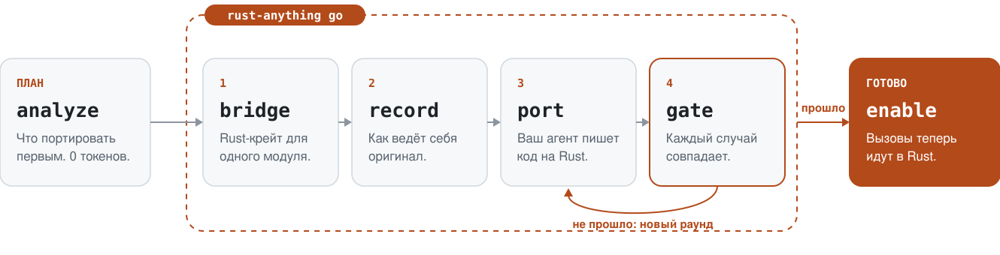

<p align="center">
  <a href="https://rustanything.ai/">
    
  </a>
</p>

<h1 align="center">Rust Anything</h1>

<p align="center">
<a href="https://crates.io/crates/rust-anything"></a>
<a href="https://www.npmjs.com/package/rust-anything"></a>
<a href="https://github.com/erkamyaman/rust-anything/stargazers"></a>
<a href="https://discord.gg/FXhUEA8eBR"></a>
<a href="https://github.com/erkamyaman/rust-anything#license"></a><br>
<a href="https://crates.io/crates/rust-anything"></a>
<a href="https://www.npmjs.com/package/rust-anything"></a>
</p>

<p align="center">
Перепишите своё приложение на Rust и докажите, что оно ведёт себя так же.
</p>

<p align="center">
<a href="https://trendshift.io/repositories/363468" target="_blank" rel="noopener noreferrer"></a>
<a href="https://trendshift.io/repositories/363468" target="_blank" rel="noopener noreferrer"></a>
</p>

<p align="center"><b>Документация:</b> <a href="https://rustanything.ai/ru">https://rustanything.ai/ru</a></p>

<p align="center"><a href="translations.md">🌐 Другие языки</a></p>

<p align="center">Переводите кодовую базу на Rust? Я консультирую по миграции на Rust: <a href="mailto:hello@rustanything.ai">hello@rustanything.ai</a></p>

<p align="center"><sub>Этот перевод поддерживается сообществом и может отставать от <a href="../README.md">английского README</a>.</sub></p>

## Спонсоры

<p align="center">Сделано в Türkiye 🇹🇷, автор <a href="https://github.com/erkamyaman">erKam Yaman</a><br>
Rust Anything бесплатный и с открытым исходным кодом. Если он помогает в работе, ваша поддержка помогает ему развиваться.</p>

<p align="center">
  <a href="https://coderabbit.link/er-kam">
    <picture>
      <source media="(prefers-color-scheme: dark)" srcset="assets/sponsors/company-dark.svg">
      
    </picture>
  </a>
</p>

<p align="center">
  <a href="https://www.atakdomain.com/">
    <picture>
      <source media="(prefers-color-scheme: dark)" srcset="assets/sponsors/domain-dark.svg">
      
    </picture>
  </a>
</p>

<p align="center">
  <a href="https://github.com/sponsors/erkamyaman">
    <picture>
      <source media="(prefers-color-scheme: dark)" srcset="assets/sponsors/sponsors-dark.svg">
      
    </picture>
  </a>
</p>

<p align="center">
  <a href="https://github.com/sponsors/erkamyaman"></a>
  <a href="https://buymeacoffee.com/erkamyaman"></a>
</p>

<p align="center">Спонсорство от компании или что-то другое? <a href="mailto:hello@rustanything.ai">hello@rustanything.ai</a></p>

<p align="center">Переводите кодовую базу на Rust? Я консультирую по миграции на Rust: <a href="mailto:hello@rustanything.ai">hello@rustanything.ai</a></p>

## Быстрый старт

Вставьте это в своего агента для кода:

```text
Install Rust Anything with npm i -g rust-anything, then run rust-anything setup. Run rust-anything go -- <slow command of this app> and finish the port until rust-anything gate passes.
```

Или установите сами:

```sh
cargo install rust-anything   # or: npm install -g rust-anything
rust-anything setup           # adds it to Claude Code, Codex, Cursor, Gemini CLI and OpenCode
```

> [!TIP]
> **Агентам:** прочитайте [rustanything.ai/llms.txt](https://rustanything.ai/llms.txt), там шаги установки, все команды и порядок портирования.

## Как это работает

<p align="center">
  <picture>
    <source media="(prefers-color-scheme: dark)" srcset="assets/how-it-works/ru-dark.svg">
    
  </picture>
</p>

**Что считается готовым.** Поведение, а не ваши тесты. `record` запускает оригинал на сгенерированных и заданных входных данных и сохраняет, что каждый вызов возвращает, выбрасывает и печатает. Порт готов, когда проходит `gate`: каждый записанный случай совпадает, а fmt, clippy, `cargo test`, проверка `unsafe`, проверка заглушек и проверка на записанные ответы, вставленные в порт, тоже проходят. Ваши собственные тесты тоже запускаются.

**Отчёт или миграция, выбирать вам.** `analyze` и `profile` только сообщают: ранжированный план того, что портировать, и что горячее всего под реальной нагрузкой. Это обычные команды, поэтому отчёт не тратит токенов. `go` переносит один модуль: строит мост к самой горячей функции, записывает её, передаёт порт вашему агенту, затем собирает, сравнивает и прогоняет через `gate`, и включает его, только когда всё совпадает (TS/JS, Python и PowerShell; `disable` выключает обратно).

**Сколько длится запуск.** Один запуск `go` портирует один модуль, максимум за `--rounds` ходов агента (по умолчанию 3): один на порт, затем по одному на каждый непройденный diff или gate. Целое приложение переносится по одному запуску на модуль, так что можно остановиться после любого из них.

**Дешёвая модель для плана, сильная для порта.** Плану модель не нужна. Для порта передайте любую команду агента: `rust-anything go --agent "claude --model <model>" -- <workload>`.

**Агенты.** `rust-anything setup` добавляет его в Claude Code, Codex, Cursor, Gemini CLI и OpenCode. Любой другой MCP-клиент может запустить `rust-anything mcp`, а навык также ставится отдельно через `npx skills add erkamyaman/rust-anything` (см. [установку](install.md)).

## Лицензия

[MIT](../LICENSE-MIT) / [Apache-2.0](../LICENSE-APACHE) © [Erkam Yaman](https://github.com/erkamyaman). Порты и сгенерированный код в вашем репозитории принадлежат вам.
