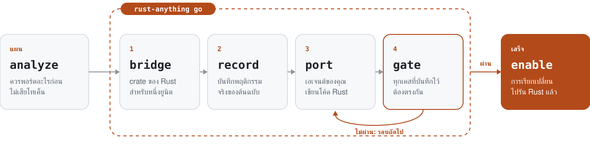

<p align="center">
  <a href="https://rustanything.ai/">
    
  </a>
</p>

<h1 align="center">Rust Anything</h1>

<p align="center">
<a href="https://crates.io/crates/rust-anything"></a>
<a href="https://www.npmjs.com/package/rust-anything"></a>
<a href="https://github.com/erkamyaman/rust-anything/stargazers"></a>
<a href="https://discord.gg/FXhUEA8eBR"></a>
<a href="https://github.com/erkamyaman/rust-anything#license"></a><br>
<a href="https://crates.io/crates/rust-anything"></a>
<a href="https://www.npmjs.com/package/rust-anything"></a>
</p>

<p align="center">
เขียนแอปของคุณใหม่ด้วย Rust และพิสูจน์ว่าพฤติกรรมการทำงานยังคงเหมือนเดิมทุกประการ
</p>

<p align="center">
<a href="https://trendshift.io/repositories/363468" target="_blank" rel="noopener noreferrer"></a>
<a href="https://trendshift.io/repositories/363468" target="_blank" rel="noopener noreferrer"></a>
</p>

<p align="center"><b>เอกสารคู่มือ:</b> <a href="https://rustanything.ai/">https://rustanything.ai/</a></p>

<p align="center"><a href="translations.md">🌐 ภาษาอื่น</a></p>

<p align="center">กำลังย้ายโค้ดเบสไปเป็น Rust อยู่หรือเปล่า? มีบริการให้คำปรึกษาด้านการย้ายระบบไปใช้ Rust: <a href="mailto:hello@rustanything.ai">hello@rustanything.ai</a></p>

<p align="center"><sub>คำแปลนี้ดูแลโดยชุมชน และอาจอัปเดตช้ากว่า <a href="../README.md">README ภาษาอังกฤษ</a></sub></p>

## ผู้สนับสนุน

<p align="center">สร้างใน Türkiye 🇹🇷 โดย <a href="https://github.com/erkamyaman">erKam Yaman</a><br>
Rust Anything ฟรีและเป็นโอเพนซอร์ส ถ้ามันช่วยงานของคุณ การสนับสนุนของคุณช่วยให้โครงการเดินหน้าต่อ</p>

<p align="center"><sub>ความปลอดภัยของคุณมาเป็นอันดับแรก: ผู้สนับสนุนจะได้รับโลโก้และลิงก์ในส่วนนี้เท่านั้น ไม่มีการรับเงินเพื่อเชียร์สินค้าและไม่มีคู่มือแนะนำผู้ให้บริการ AI API ภายนอก ดังนั้นจะไม่มีสิ่งใดในนี้ชี้นำโค้ด คีย์ หรือข้อมูลของคุณไปยังที่ที่คุณไม่ได้เลือก</sub></p>

<p align="center">
  <a href="https://coderabbit.link/er-kam">
    <picture>
      <source media="(prefers-color-scheme: dark)" srcset="assets/sponsors/company-dark.svg">
      
    </picture>
  </a>
</p>

<p align="center">
  <a href="https://www.atakdomain.com/">
    <picture>
      <source media="(prefers-color-scheme: dark)" srcset="assets/sponsors/domain-dark.svg">
      
    </picture>
  </a>
</p>

<p align="center">
  <a href="https://github.com/sponsors/erkamyaman">
    <picture>
      <source media="(prefers-color-scheme: dark)" srcset="assets/sponsors/sponsors-dark.svg">
      
    </picture>
  </a>
</p>

<p align="center">
  <a href="https://github.com/sponsors/erkamyaman"></a>
  <a href="https://buymeacoffee.com/erkamyaman"></a>
</p>

<p align="center">ต้องการสนับสนุนในนามบริษัท หรือเรื่องอื่น ๆ? <a href="mailto:hello@rustanything.ai">hello@rustanything.ai</a></p>

<p align="center">กำลังย้ายโค้ดเบสไปเป็น Rust อยู่หรือเปล่า? มีบริการให้คำปรึกษาด้านการย้ายระบบไปใช้ Rust: <a href="mailto:hello@rustanything.ai">hello@rustanything.ai</a></p>

## เริ่มต้นอย่างรวดเร็ว

วางข้อความนี้ลงในเอเจนต์เขียนโค้ดของคุณ:

```text
Install Rust Anything with npm i -g rust-anything, then run rust-anything setup. Run rust-anything go -- <slow command of this app> and finish the port until rust-anything gate passes.
```

หรือติดตั้งเอง:

```sh
cargo install rust-anything   # or: npm install -g rust-anything
rust-anything setup           # adds it to Claude Code, Codex, Cursor, Gemini CLI and OpenCode
```

> [!TIP]
> **สำหรับเอเจนต์:** อ่าน [rustanything.ai/llms.txt](https://rustanything.ai/llms.txt) เพื่อดูขั้นตอนติดตั้ง คำสั่งทั้งหมด และขั้นตอนการพอร์ต

## วิธีการทำงาน

<p align="center">
  <picture>
    <source media="(prefers-color-scheme: dark)" srcset="assets/how-it-works/th-dark.svg">
    
  </picture>
</p>

**อะไรนับว่าเสร็จ** พฤติกรรม ไม่ใช่เทสต์ของคุณ `record` รันโค้ดต้นฉบับกับอินพุตที่สร้างขึ้นและอินพุตที่กำหนดให้ แล้วบันทึกสิ่งที่แต่ละการเรียกคืนค่า โยนออกมา และพิมพ์ออกมา การพอร์ตถือว่าเสร็จเมื่อ `gate` ผ่าน: ทุกเคสที่บันทึกไว้ตรงกัน และ fmt, clippy, `cargo test`, การตรวจ `unsafe`, การตรวจ stub และการตรวจว่ามีคำตอบที่บันทึกไว้ถูกแปะลงในโค้ดที่พอร์ตหรือไม่ ผ่านทั้งหมด เทสต์ของคุณเองก็รันด้วย

**รายงานหรือย้ายจริง คุณเลือกได้** `analyze` และ `profile` แค่รายงาน: แผนที่จัดลำดับว่าควรพอร์ตอะไร และส่วนไหนร้อนที่สุดภายใต้งานจริง ทั้งสองเป็นคำสั่งธรรมดา รายงานจึงไม่เสียโทเค็นเลย `go` ย้ายทีละหนึ่งยูนิต: สร้างบริดจ์ให้ฟังก์ชันที่ร้อนที่สุด บันทึกมัน ส่งงานพอร์ตให้เอเจนต์ของคุณ จากนั้น build, diff และรัน `gate` แล้วเปิดใช้เฉพาะเมื่อทุกอย่างตรงกัน (TS/JS, Python และ PowerShell; `disable` ปิดกลับได้)

**การรันหนึ่งครั้งใช้เวลาแค่ไหน** การรัน `go` หนึ่งครั้งพอร์ตหนึ่งยูนิต โดยใช้เอเจนต์ไม่เกิน `--rounds` รอบ (ค่าเริ่มต้น 3): หนึ่งรอบสำหรับการพอร์ต แล้วอีกหนึ่งรอบต่อ diff หรือ gate ที่ไม่ผ่าน ทั้งแอปคือการรันหนึ่งครั้งต่อหนึ่งยูนิต คุณจึงหยุดหลังครั้งไหนก็ได้

**โมเดลราคาถูกสำหรับแผน โมเดลเก่งสำหรับการพอร์ต** แผนไม่ต้องใช้โมเดล สำหรับการพอร์ต ส่งคำสั่งเอเจนต์อะไรก็ได้: `rust-anything go --agent "claude --model <model>" -- <workload>`

**เอเจนต์** `rust-anything setup` เพิ่มเข้าไปใน Claude Code, Codex, Cursor, Gemini CLI และ OpenCode ไคลเอนต์ MCP อื่นใดก็รัน `rust-anything mcp` ได้ และสกิลยังติดตั้งแยกได้ด้วย `npx skills add erkamyaman/rust-anything` (ดู[การติดตั้ง](install.md))

## สัญญาอนุญาต

[MIT](../LICENSE-MIT) / [Apache-2.0](../LICENSE-APACHE) © [Erkam Yaman](https://github.com/erkamyaman) โค้ดที่พอร์ตและโค้ดที่สร้างขึ้นในคลังของคุณเป็นกรรมสิทธิ์ของคุณทั้งหมด
