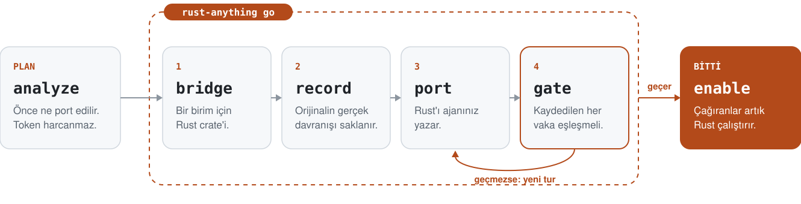

<p align="center">
  <a href="https://rustanything.ai/">
    
  </a>
</p>

<h1 align="center">Rust Anything</h1>

<p align="center">
<a href="https://crates.io/crates/rust-anything"></a>
<a href="https://www.npmjs.com/package/rust-anything"></a>
<a href="https://github.com/erkamyaman/rust-anything/stargazers"></a>
<a href="https://discord.gg/FXhUEA8eBR"></a>
<a href="https://github.com/erkamyaman/rust-anything#license"></a><br>
<a href="https://rustanything.ai/"></a>
<a href="https://crates.io/crates/rust-anything"></a>
<a href="https://www.npmjs.com/package/rust-anything"></a>
</p>

<p align="center">
Uygulamanızı Rust ile yeniden yazın ve hâlâ aynı davrandığını kanıtlayın.
</p>

<p align="center">
<a href="https://trendshift.io/repositories/363468" target="_blank" rel="noopener noreferrer"></a>
<a href="https://trendshift.io/repositories/363468" target="_blank" rel="noopener noreferrer"></a>
</p>

<p align="center"><b>Dokümantasyon:</b> <a href="https://rustanything.ai/tr">https://rustanything.ai/tr</a></p>

<p align="center"><a href="translations.md">🌐 Diğer diller</a></p>

<p align="center">Bir kod tabanını Rust'a mı taşıyorsunuz? Rust geçişleri için danışmanlık veriyorum: <a href="mailto:hello@rustanything.ai">hello@rustanything.ai</a></p>

<p align="center"><sub>Bu çeviri topluluk tarafından sürdürülmektedir ve <a href="../README.md">İngilizce README</a>'nin gerisinde kalabilir.</sub></p>

## Sponsorlar

<p align="center">Türkiye'de 🇹🇷 <a href="https://github.com/erkamyaman">erKam Yaman</a> tarafından yapıldı<br>
Rust Anything ücretsiz ve açık kaynaktır. İşinize yarıyorsa, sponsor olmanız geliştirmeyi sürdürür.</p>

<p align="center">
  <a href="https://coderabbit.link/er-kam">
    <picture>
      <source media="(prefers-color-scheme: dark)" srcset="assets/sponsors/company-dark.svg">
      
    </picture>
  </a>
</p>

<p align="center">
  <a href="https://www.atakdomain.com/">
    <picture>
      <source media="(prefers-color-scheme: dark)" srcset="assets/sponsors/domain-dark.svg">
      
    </picture>
  </a>
</p>

<p align="center">
  <a href="https://github.com/sponsors/erkamyaman">
    <picture>
      <source media="(prefers-color-scheme: dark)" srcset="assets/sponsors/sponsors-dark.svg">
      
    </picture>
  </a>
</p>

<p align="center">
  <a href="https://github.com/sponsors/erkamyaman"></a>
  <a href="https://buymeacoffee.com/erkamyaman"></a>
</p>

<p align="center">Şirket olarak sponsorluk ya da başka bir konu mu? <a href="mailto:hello@rustanything.ai">hello@rustanything.ai</a></p>

<p align="center">Bir kod tabanını Rust'a mı taşıyorsunuz? Rust geçişleri için danışmanlık veriyorum: <a href="mailto:hello@rustanything.ai">hello@rustanything.ai</a></p>

## Hızlı başlangıç

Bunu kodlama ajanınıza yapıştırın:

```text
Install Rust Anything with npm i -g rust-anything, then run rust-anything setup. Run rust-anything go -- <slow command of this app> and finish the port until rust-anything gate passes.
```

Ya da kendiniz kurun:

```sh
cargo install rust-anything   # or: npm install -g rust-anything
rust-anything setup           # adds it to Claude Code, Codex, Cursor, Gemini CLI and OpenCode
```

> [!TIP]
> **Ajanlar:** kurulum adımları, tüm komutlar ve port etme akışı için [rustanything.ai/llms.txt](https://rustanything.ai/llms.txt) dosyasını okuyun.

## Nasıl çalışır

<p align="center">
  <picture>
    <source media="(prefers-color-scheme: dark)" srcset="assets/how-it-works/tr-dark.svg">
    
  </picture>
</p>

**Ne zaman bitmiş sayılır.** Testleriniz değil, davranış. `record` orijinali üretilmiş ve verilmiş girdilerle çalıştırır ve her çağrının döndürdüğünü, fırlattığını ve yazdırdığını kaydeder. Bir port, `gate` geçtiğinde biter: kaydedilen her vaka eşleşir; fmt, clippy, `cargo test`, `unsafe` kontrolü, stub kontrolü ve porta yapıştırılmış kayıtlı cevap kontrolü de geçer. Kendi testleriniz de çalışır.

**Rapor mu, taşıma mı, siz seçin.** `analyze` ve `profile` yalnızca rapor verir: neyin port edileceğine dair sıralı bir plan ve gerçek bir iş yükü altında neyin sıcak olduğu. Bunlar düz komutlardır, bu yüzden rapor hiç token harcamaz. `go` bir birimi taşır: en sıcak fonksiyon için köprü kurar, onu kaydeder, portu ajanınıza verir, sonra derler, karşılaştırır ve `gate`'ten geçirir; yalnızca her şey eşleşirse devreye alır (TS/JS, Python ve PowerShell; `disable` yeniden kapatır).

**Bir çalıştırma ne kadar sürer.** Bir `go` çalıştırması bir birimi port eder ve en fazla `--rounds` ajan turu kullanır (varsayılan 3): biri port için, sonra başarısız her diff ya da gate için bir tane. Bütün bir uygulama birim başına bir çalıştırmadır, yani herhangi birinden sonra durabilirsiniz.

**Plan için ucuz model, port için güçlü model.** Plan için model gerekmez. Port için herhangi bir ajan komutu verin: `rust-anything go --agent "claude --model <model>" -- <workload>`.

**Ajanlar.** `rust-anything setup` onu Claude Code, Codex, Cursor, Gemini CLI ve OpenCode'a ekler. Diğer MCP istemcileri `rust-anything mcp` çalıştırabilir; skill ayrıca `npx skills add erkamyaman/rust-anything` ile tek başına da kurulur (bkz. [kurulum](install.md)).

## Lisans

[MIT](../LICENSE-MIT) / [Apache-2.0](../LICENSE-APACHE) © [Erkam Yaman](https://github.com/erkamyaman). Reponuzdaki portlar ve üretilmiş kod sizindir.
