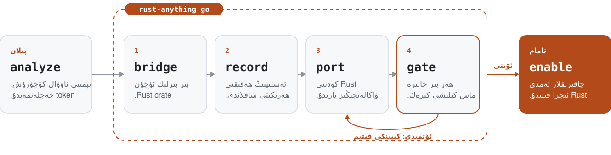

<p align="center">
  <a href="https://rustanything.ai/">
    
  </a>
</p>

<h1 align="center">Rust Anything</h1>

<p align="center">
<a href="https://crates.io/crates/rust-anything"></a>
<a href="https://www.npmjs.com/package/rust-anything"></a>
<a href="https://github.com/erkamyaman/rust-anything/stargazers"></a>
<a href="https://discord.gg/FXhUEA8eBR"></a>
<a href="https://github.com/erkamyaman/rust-anything#license"></a><br>
<a href="https://rustanything.ai/"></a>
<a href="https://crates.io/crates/rust-anything"></a>
<a href="https://www.npmjs.com/package/rust-anything"></a>
</p>

<div dir="rtl">

<p align="center">
ئەپىڭىزنى Rust دا قايتا يېزىڭ، ھەمدە ئۇنىڭ يەنىلا ئوخشاش ئىشلەيدىغانلىقىنى ئىسپاتلاڭ.
</p>

<p align="center">
<a href="https://trendshift.io/repositories/363468" target="_blank" rel="noopener noreferrer"></a>
<a href="https://trendshift.io/repositories/363468" target="_blank" rel="noopener noreferrer"></a>
</p>

<p align="center"><b>قوللانما:</b> <a href="https://rustanything.ai/">https://rustanything.ai/</a></p>

<p align="center"><a href="translations.md">🌐 باشقا تىللار</a></p>

<p align="center">كود ئامبىرىڭىزنى Rust قا كۆچۈرمەكچىمۇ؟ Rust قا كۆچۈش توغرىسىدا مەسلىھەت مۇلازىمىتى بېرىمەن: <a href="mailto:hello@rustanything.ai">hello@rustanything.ai</a></p>

<p align="center"><sub>بۇ تەرجىمىنى جامائەت ئاسرايدۇ، شۇڭا ئۇ <a href="../README.md">ئىنگلىزچە README</a> دىن ئارقىدا قېلىشى مۇمكىن.</sub></p>

## ھامىيلار

<p align="center">Türkiye 🇹🇷 دە <a href="https://github.com/erkamyaman">erKam Yaman</a> ياسىغان<br>
Rust Anything ھەقسىز ۋە ئوچۇق كودلۇق. خىزمىتىڭىزگە پايدىسى تەگسە، ياردىمىڭىز ئۇنى داۋاملاشتۇرىدۇ.</p>

<p align="center">
  <a href="https://coderabbit.link/er-kam">
    <picture>
      <source media="(prefers-color-scheme: dark)" srcset="assets/sponsors/company-dark.svg">
      
    </picture>
  </a>
</p>

<p align="center">
  <a href="https://www.atakdomain.com/">
    <picture>
      <source media="(prefers-color-scheme: dark)" srcset="assets/sponsors/domain-dark.svg">
      
    </picture>
  </a>
</p>

<p align="center">
  <a href="https://github.com/sponsors/erkamyaman">
    <picture>
      <source media="(prefers-color-scheme: dark)" srcset="assets/sponsors/sponsors-dark.svg">
      
    </picture>
  </a>
</p>

<p align="center">
  <a href="https://github.com/sponsors/erkamyaman"></a>
  <a href="https://buymeacoffee.com/erkamyaman"></a>
</p>

<p align="center">شىركەت سۈپىتىدە ھامىيلىق قىلماقچىمۇ ياكى باشقا ئىش بارمۇ؟ <a href="mailto:hello@rustanything.ai">hello@rustanything.ai</a></p>

<p align="center">كود ئامبىرىڭىزنى Rust قا كۆچۈرمەكچىمۇ؟ Rust قا كۆچۈش توغرىسىدا مەسلىھەت مۇلازىمىتى بېرىمەن: <a href="mailto:hello@rustanything.ai">hello@rustanything.ai</a></p>

## تېز باشلاش

بۇنى كود يازىدىغان ۋاكالەتچىڭىزگە چاپلاڭ:

```text
Install Rust Anything with npm i -g rust-anything, then run rust-anything setup. Run rust-anything go -- <slow command of this app> and finish the port until rust-anything gate passes.
```

ياكى ئۆزىڭىز ئورنىتىڭ:

```sh
cargo install rust-anything   # or: npm install -g rust-anything
rust-anything setup           # adds it to Claude Code, Codex, Cursor, Gemini CLI and OpenCode
```

> **ۋاكالەتچىلەرگە:** ئورنىتىش قەدەملىرى، بارلىق بۇيرۇقلار ۋە كۆچۈرۈش جەريانى ئۈچۈن [rustanything.ai/llms.txt](https://rustanything.ai/llms.txt) نى ئوقۇڭ.

## قانداق ئىشلەيدۇ

<p align="center">
  <picture>
    <source media="(prefers-color-scheme: dark)" srcset="assets/how-it-works/ug-dark.svg">
    
  </picture>
</p>

**نېمە تامام دەپ ھېسابلىنىدۇ.** سىزنىڭ سىناقلىرىڭىز ئەمەس، ھەرىكەت. `record` ئەسلىي پروگراممىنى ھاسىل قىلىنغان ۋە بېرىلگەن كىرگۈزمىلەر بىلەن ئىجرا قىلىپ، ھەر بىر چاقىرىقنىڭ قايتۇرغىنى، تاشلىغىنى ۋە بېسىپ چىقارغىنىنى ساقلايدۇ. `gate` ئۆتسە كۆچۈرۈش تامام بولىدۇ: خاتىرىلەنگەن ھەر بىر ئەھۋال ماس كېلىدۇ، ھەمدە fmt، clippy، `cargo test`، `unsafe` تەكشۈرۈشى، stub تەكشۈرۈشى ۋە كۆچۈرمىگە چاپلانغان خاتىرىلەنگەن جاۋابلارنى تەكشۈرۈش ھەممىسى ئۆتىدۇ. ئۆزىڭىزنىڭ سىناقلىرىمۇ ئىجرا قىلىنىدۇ.

**دوكلاتمۇ ياكى كۆچۈرۈشمۇ، ئۆزىڭىز تاللاڭ.** `analyze` ۋە `profile` پەقەت دوكلات بېرىدۇ: نېمىنى كۆچۈرۈش كېرەكلىكى ھەققىدە تەرتىپلەنگەن پىلان، ۋە ھەقىقىي يۈك ئاستىدا قايسى قىسىمنىڭ ئەڭ كۆپ ۋاقىت ئالىدىغانلىقى. بۇلار ئاددىي بۇيرۇقلار، شۇڭا دوكلات ھېچقانداق token خەجلىمەيدۇ. `go` بىر بىرلىكنى كۆچۈرىدۇ: ئەڭ كۆپ ۋاقىت ئالىدىغان فۇنكسىيە ئۈچۈن كۆۋرۈك قۇرىدۇ، ئۇنى خاتىرىلەيدۇ، كۆچۈرۈشنى ۋاكالەتچىڭىزگە تاپشۇرىدۇ، ئاندىن قۇرۇپ چىقىدۇ، سېلىشتۇرىدۇ ۋە `gate` دىن ئۆتكۈزىدۇ، ھەممە نەرسە ماس كەلگەندىلا ئۇنى قوزغىتىدۇ (TS/JS، Python ۋە PowerShell؛ `disable` ئۇنى قايتا تاقايدۇ).

**بىر قېتىملىق ئىجرا قانچىلىك ۋاقىت ئالىدۇ.** بىر قېتىملىق `go` ئىجراسى بىر بىرلىكنى كۆچۈرىدۇ، ۋاكالەتچى ئەڭ كۆپ بولغاندا `--rounds` نۆۋەت ئىشلەيدۇ (كۆڭۈلدىكىسى 3): بىرى كۆچۈرۈش ئۈچۈن، ئاندىن مەغلۇپ بولغان ھەر بىر diff ياكى gate ئۈچۈن بىردىن. پۈتۈن ئەپ ھەر بىر بىرلىك ئۈچۈن بىر قېتىملىق ئىجرادىن تەركىب تاپىدۇ، شۇڭا خالىغان بىرىدىن كېيىن توختىسىڭىز بولىدۇ.

**پىلان ئۈچۈن ئەرزان مودېل، كۆچۈرۈش ئۈچۈن كۈچلۈك مودېل.** پىلانغا مودېل كېرەك ئەمەس. كۆچۈرۈش ئۈچۈن خالىغان ۋاكالەتچى بۇيرۇقىنى بېرىڭ: `rust-anything go --agent "claude --model <model>" -- <workload>`.

**ۋاكالەتچىلەر.** `rust-anything setup` ئۇنى Claude Code، Codex، Cursor، Gemini CLI ۋە OpenCode غا قوشىدۇ. باشقا ھەر قانداق MCP خېرىدارى `rust-anything mcp` نى ئىجرا قىلالايدۇ، skill نى يەنە `npx skills add erkamyaman/rust-anything` ئارقىلىق ئايرىم ئورناتقىلى بولىدۇ ([ئورنىتىش](install.md) غا قاراڭ).

## ئىجازەتنامە

[MIT](../LICENSE-MIT) / [Apache-2.0](../LICENSE-APACHE) © [Erkam Yaman](https://github.com/erkamyaman). ئامبىرىڭىزدىكى كۆچۈرمىلەر ۋە ھاسىل قىلىنغان كود سىزنىڭ.

</div>
