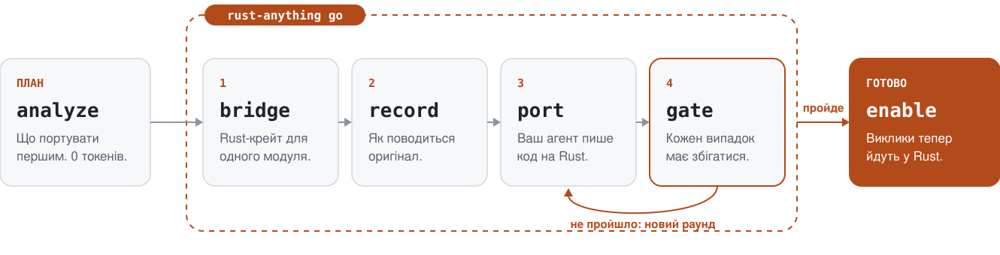

<p align="center">
  <a href="https://rustanything.ai/">
    
  </a>
</p>

<h1 align="center">Rust Anything</h1>

<p align="center">
<a href="https://crates.io/crates/rust-anything"></a>
<a href="https://www.npmjs.com/package/rust-anything"></a>
<a href="https://github.com/erkamyaman/rust-anything/stargazers"></a>
<a href="https://discord.gg/FXhUEA8eBR"></a>
<a href="https://github.com/erkamyaman/rust-anything#license"></a><br>
<a href="https://rustanything.ai/"></a>
<a href="https://crates.io/crates/rust-anything"></a>
<a href="https://www.npmjs.com/package/rust-anything"></a>
</p>

<p align="center">
Перепишіть свій застосунок на Rust і доведіть, що він поводиться так само.
</p>

<p align="center">
<a href="https://trendshift.io/repositories/363468" target="_blank" rel="noopener noreferrer"></a>
<a href="https://trendshift.io/repositories/363468" target="_blank" rel="noopener noreferrer"></a>
</p>

<p align="center"><b>Документація:</b> <a href="https://rustanything.ai/uk">https://rustanything.ai/uk</a></p>

<p align="center"><a href="translations.md">🌐 Інші мови</a></p>

<p align="center">Переносите кодову базу на Rust? Я консультую з міграції на Rust: <a href="mailto:hello@rustanything.ai">hello@rustanything.ai</a></p>

<p align="center"><sub>Цей переклад підтримує спільнота, тому він може відставати від <a href="../README.md">англійського README</a>.</sub></p>

## Спонсори

<p align="center">Зроблено в Türkiye 🇹🇷, автор <a href="https://github.com/erkamyaman">erKam Yaman</a><br>
Rust Anything безкоштовний і з відкритим кодом. Якщо він допомагає у вашій роботі, спонсорство допомагає йому розвиватися.</p>

<p align="center">
  <a href="https://coderabbit.link/er-kam">
    <picture>
      <source media="(prefers-color-scheme: dark)" srcset="assets/sponsors/company-dark.svg">
      
    </picture>
  </a>
</p>

<p align="center">
  <a href="https://www.atakdomain.com/">
    <picture>
      <source media="(prefers-color-scheme: dark)" srcset="assets/sponsors/domain-dark.svg">
      
    </picture>
  </a>
</p>

<p align="center">
  <a href="https://github.com/sponsors/erkamyaman">
    <picture>
      <source media="(prefers-color-scheme: dark)" srcset="assets/sponsors/sponsors-dark.svg">
      
    </picture>
  </a>
</p>

<p align="center">
  <a href="https://github.com/sponsors/erkamyaman"></a>
  <a href="https://buymeacoffee.com/erkamyaman"></a>
</p>

<p align="center">Спонсорство від компанії чи щось інше? <a href="mailto:hello@rustanything.ai">hello@rustanything.ai</a></p>

<p align="center">Переносите кодову базу на Rust? Я консультую з міграції на Rust: <a href="mailto:hello@rustanything.ai">hello@rustanything.ai</a></p>

## Швидкий старт

Вставте це у свого агента для коду:

```text
Install Rust Anything with npm i -g rust-anything, then run rust-anything setup. Run rust-anything go -- <slow command of this app> and finish the port until rust-anything gate passes.
```

Або встановіть самі:

```sh
cargo install rust-anything   # or: npm install -g rust-anything
rust-anything setup           # adds it to Claude Code, Codex, Cursor, Gemini CLI and OpenCode
```

> [!TIP]
> **Агентам:** прочитайте [rustanything.ai/llms.txt](https://rustanything.ai/llms.txt), там кроки встановлення, усі команди й порядок портування.

## Як це працює

<p align="center">
  <picture>
    <source media="(prefers-color-scheme: dark)" srcset="assets/how-it-works/uk-dark.svg">
    
  </picture>
</p>

**Що вважається готовим.** Поведінка, а не ваші тести. `record` запускає оригінал на згенерованих і заданих вхідних даних і зберігає, що кожен виклик повертає, викидає і друкує. Порт готовий, коли проходить `gate`: кожен записаний випадок збігається, а fmt, clippy, `cargo test`, перевірка `unsafe`, перевірка заглушок і перевірка на записані відповіді, вставлені в порт, теж проходять. Ваші власні тести теж запускаються.

**Звіт чи міграція, вирішувати вам.** `analyze` і `profile` лише звітують: упорядкований план того, що портувати, і що найгарячіше під реальним навантаженням. Це звичайні команди, тож звіт не витрачає токенів. `go` переносить один модуль: будує міст до найгарячішої функції, записує її, передає порт вашому агенту, потім збирає, порівнює і проганяє через `gate`, і вмикає його лише тоді, коли все збігається (TS/JS, Python і PowerShell; `disable` вимикає назад).

**Скільки триває запуск.** Один запуск `go` портує один модуль, щонайбільше за `--rounds` ходів агента (типово 3): один на порт, потім по одному на кожен непройдений diff чи gate. Цілий застосунок переноситься по одному запуску на модуль, тож можна зупинитися після будь-якого з них.

**Дешева модель для плану, сильна для порту.** Плану модель не потрібна. Для порту передайте будь-яку команду агента: `rust-anything go --agent "claude --model <model>" -- <workload>`.

**Агенти.** `rust-anything setup` додає його до Claude Code, Codex, Cursor, Gemini CLI і OpenCode. Будь-який інший MCP-клієнт може запустити `rust-anything mcp`, а навичка також встановлюється окремо через `npx skills add erkamyaman/rust-anything` (див. [встановлення](install.md)).

## Ліцензія

[MIT](../LICENSE-MIT) / [Apache-2.0](../LICENSE-APACHE) © [Erkam Yaman](https://github.com/erkamyaman). Порти і згенерований код у вашому репозиторії належать вам.
