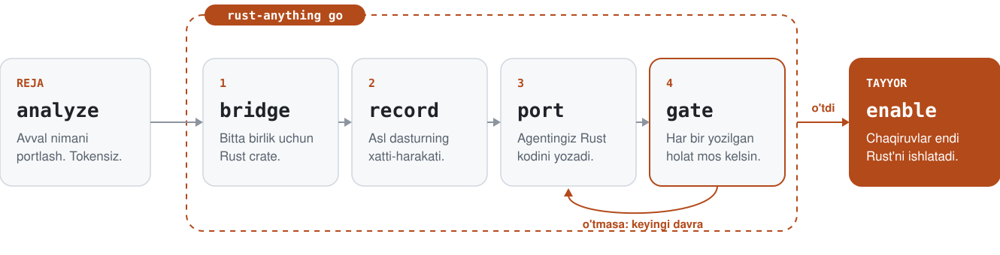

<p align="center">
  <a href="https://rustanything.ai/">
    
  </a>
</p>

<h1 align="center">Rust Anything</h1>

<p align="center">
<a href="https://crates.io/crates/rust-anything"></a>
<a href="https://www.npmjs.com/package/rust-anything"></a>
<a href="https://github.com/erkamyaman/rust-anything/stargazers"></a>
<a href="https://discord.gg/FXhUEA8eBR"></a>
<a href="https://github.com/erkamyaman/rust-anything#license"></a><br>
<a href="https://rustanything.ai/"></a>
<a href="https://crates.io/crates/rust-anything"></a>
<a href="https://www.npmjs.com/package/rust-anything"></a>
</p>

<p align="center">
Ilovangizni Rust'da qayta yozing va u hamon xuddi shunday ishlashini isbotlang.
</p>

<p align="center">
<a href="https://trendshift.io/repositories/363468" target="_blank" rel="noopener noreferrer"></a>
<a href="https://trendshift.io/repositories/363468" target="_blank" rel="noopener noreferrer"></a>
</p>

<p align="center"><b>Hujjatlar:</b> <a href="https://rustanything.ai/uz">https://rustanything.ai/uz</a></p>

<p align="center"><a href="translations.md">🌐 Boshqa tillar</a></p>

<p align="center">Kod bazangizni Rust'ga ko'chiryapsizmi? Rust'ga migratsiya bo'yicha konsalting xizmatini taklif qilaman: <a href="mailto:hello@rustanything.ai">hello@rustanything.ai</a></p>

<p align="center"><sub>Bu tarjima hamjamiyat tomonidan yuritiladi va <a href="../README.md">inglizcha README</a>dan ortda qolishi mumkin.</sub></p>

## Homiylar

<p align="center">Türkiye 🇹🇷 da <a href="https://github.com/erkamyaman">erKam Yaman</a> tomonidan yaratilgan<br>
Rust Anything bepul va ochiq manbali. Agar ishingizga yordam bersa, homiyligingiz uni davom ettiradi.</p>

<p align="center">
  <a href="https://coderabbit.link/er-kam">
    <picture>
      <source media="(prefers-color-scheme: dark)" srcset="assets/sponsors/company-dark.svg">
      
    </picture>
  </a>
</p>

<p align="center">
  <a href="https://www.atakdomain.com/">
    <picture>
      <source media="(prefers-color-scheme: dark)" srcset="assets/sponsors/domain-dark.svg">
      
    </picture>
  </a>
</p>

<p align="center">
  <a href="https://github.com/sponsors/erkamyaman">
    <picture>
      <source media="(prefers-color-scheme: dark)" srcset="assets/sponsors/sponsors-dark.svg">
      
    </picture>
  </a>
</p>

<p align="center">
  <a href="https://github.com/sponsors/erkamyaman"></a>
  <a href="https://buymeacoffee.com/erkamyaman"></a>
</p>

<p align="center">Kompaniya sifatida homiylik yoki boshqa biror narsa? <a href="mailto:hello@rustanything.ai">hello@rustanything.ai</a></p>

<p align="center">Kod bazangizni Rust'ga ko'chiryapsizmi? Rust'ga migratsiya bo'yicha konsalting xizmatini taklif qilaman: <a href="mailto:hello@rustanything.ai">hello@rustanything.ai</a></p>

## Tezkor boshlash

Buni kod yozuvchi agentingizga joylashtiring:

```text
Install Rust Anything with npm i -g rust-anything, then run rust-anything setup. Run rust-anything go -- <slow command of this app> and finish the port until rust-anything gate passes.
```

Yoki o'zingiz o'rnating:

```sh
cargo install rust-anything   # or: npm install -g rust-anything
rust-anything setup           # adds it to Claude Code, Codex, Cursor, Gemini CLI and OpenCode
```

> [!TIP]
> **Agentlar:** o'rnatish qadamlari, barcha buyruqlar va portlash jarayoni uchun [rustanything.ai/llms.txt](https://rustanything.ai/llms.txt) ni o'qing.

## Qanday ishlaydi

<p align="center">
  <picture>
    <source media="(prefers-color-scheme: dark)" srcset="assets/how-it-works/uz-dark.svg">
    
  </picture>
</p>

**Nima tayyor hisoblanadi.** Sizning testlaringiz emas, xatti-harakat. `record` asl dasturni generatsiya qilingan va berilgan kirish ma'lumotlarida ishga tushiradi va har bir chaqiruv nima qaytarishi, nima tashlashi va nima chop etishini saqlaydi. Port `gate` o'tganda tayyor bo'ladi: yozib olingan har bir holat mos keladi, shuningdek fmt, clippy, `cargo test`, `unsafe` tekshiruvi, stub tekshiruvi va portga qo'yilgan yozib olingan javoblarni tekshirish ham o'tadi. O'z testlaringiz ham ishga tushadi.

**Hisobot yoki migratsiya, o'zingiz tanlaysiz.** `analyze` va `profile` faqat hisobot beradi: nimani portlash kerakligi bo'yicha tartiblangan reja va real yuklama ostida nima eng ko'p vaqt olishi. Bular oddiy buyruqlar, shuning uchun hisobot hech qanday token sarflamaydi. `go` bitta birlikni ko'chiradi: eng qaynoq funksiya uchun ko'prik quradi, uni yozib oladi, portni agentingizga beradi, so'ng yig'adi, solishtiradi va `gate` orqali o'tkazadi, hammasi mos kelgandagina yoqadi (TS/JS, Python va PowerShell; `disable` uni qayta o'chiradi).

**Bitta ishga tushirish qancha davom etadi.** Bitta `go` ishga tushirishi bitta birlikni portlaydi, ko'pi bilan `--rounds` agent navbati bilan (standart 3): biri port uchun, so'ng har bir muvaffaqiyatsiz diff yoki gate uchun bittadan. Butun ilova har bir birlik uchun bitta ishga tushirishdan iborat, shuning uchun istalganidan keyin to'xtashingiz mumkin.

**Reja uchun arzon model, port uchun kuchli model.** Rejaga model kerak emas. Port uchun istalgan agent buyrug'ini bering: `rust-anything go --agent "claude --model <model>" -- <workload>`.

**Agentlar.** `rust-anything setup` uni Claude Code, Codex, Cursor, Gemini CLI va OpenCode'ga qo'shadi. Har qanday boshqa MCP mijozi `rust-anything mcp` ni ishga tushira oladi, skill esa `npx skills add erkamyaman/rust-anything` orqali alohida ham o'rnatiladi ([o'rnatish](install.md) bo'limiga qarang).

## Litsenziya

[MIT](../LICENSE-MIT) / [Apache-2.0](../LICENSE-APACHE) © [Erkam Yaman](https://github.com/erkamyaman). Repozitoriyingizdagi portlar va generatsiya qilingan kod sizniki.
