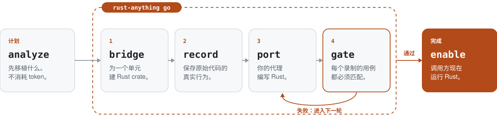

<p align="center">
  <a href="https://rustanything.ai/">
    
  </a>
</p>

<h1 align="center">Rust Anything</h1>

<p align="center">
<a href="https://crates.io/crates/rust-anything"></a>
<a href="https://www.npmjs.com/package/rust-anything"></a>
<a href="https://github.com/erkamyaman/rust-anything/stargazers"></a>
<a href="https://discord.gg/FXhUEA8eBR"></a>
<a href="https://github.com/erkamyaman/rust-anything#license"></a><br>
<a href="https://crates.io/crates/rust-anything"></a>
<a href="https://www.npmjs.com/package/rust-anything"></a>
</p>

<p align="center">
用 Rust 重写你的应用，并证明它的行为依然完全一致。
</p>

<p align="center">
<a href="https://trendshift.io/repositories/363468" target="_blank" rel="noopener noreferrer"></a>
<a href="https://trendshift.io/repositories/363468" target="_blank" rel="noopener noreferrer"></a>
</p>

<p align="center"><b>文档:</b> <a href="https://rustanything.ai/zh">https://rustanything.ai/zh</a></p>

<p align="center"><a href="translations.md">🌐 其他语言</a></p>

<p align="center">要把代码库迁移到 Rust？我提供 Rust 迁移咨询： <a href="mailto:hello@rustanything.ai">hello@rustanything.ai</a></p>

<p align="center"><sub>本译文由社区维护，可能落后于<a href="../README.md">英文 README</a>。</sub></p>

## 赞助商

<p align="center">由 <a href="https://github.com/erkamyaman">erKam Yaman</a> 在 Türkiye 🇹🇷 制作<br>
Rust Anything 免费且开源。如果它对你的工作有帮助，你的赞助能让它持续发展。</p>

<p align="center">
  <a href="https://coderabbit.link/er-kam">
    <picture>
      <source media="(prefers-color-scheme: dark)" srcset="assets/sponsors/company-dark.svg">
      
    </picture>
  </a>
</p>

<p align="center">
  <a href="https://www.atakdomain.com/">
    <picture>
      <source media="(prefers-color-scheme: dark)" srcset="assets/sponsors/domain-dark.svg">
      
    </picture>
  </a>
</p>

<p align="center">
  <a href="https://github.com/sponsors/erkamyaman">
    <picture>
      <source media="(prefers-color-scheme: dark)" srcset="assets/sponsors/sponsors-dark.svg">
      
    </picture>
  </a>
</p>

<p align="center">
  <a href="https://github.com/sponsors/erkamyaman"></a>
  <a href="https://buymeacoffee.com/erkamyaman"></a>
</p>

<p align="center">以公司身份赞助，或有其他事宜？ <a href="mailto:hello@rustanything.ai">hello@rustanything.ai</a></p>

<p align="center">要把代码库迁移到 Rust？我提供 Rust 迁移咨询： <a href="mailto:hello@rustanything.ai">hello@rustanything.ai</a></p>

## 快速开始

把这段粘贴到你的编程代理中：

```text
Install Rust Anything with npm i -g rust-anything, then run rust-anything setup. Run rust-anything go -- <slow command of this app> and finish the port until rust-anything gate passes.
```

或者自己安装：

```sh
cargo install rust-anything   # or: npm install -g rust-anything
rust-anything setup           # adds it to Claude Code, Codex, Cursor, Gemini CLI and OpenCode
```

> [!TIP]
> **代理：**阅读 [rustanything.ai/llms.txt](https://rustanything.ai/llms.txt)，了解安装步骤、全部命令和移植流程。

## 工作原理

<p align="center">
  <picture>
    <source media="(prefers-color-scheme: dark)" srcset="assets/how-it-works/zh-dark.svg">
    
  </picture>
</p>

**怎样才算完成。** 看行为，而不是你的测试。`record` 用生成的和给定的输入运行原始代码，保存每次调用的返回值、抛出的异常和打印的输出。`gate` 通过时移植才算完成：每个录制的用例都匹配，并且 fmt、clippy、`cargo test`、`unsafe` 检查、桩代码检查，以及检查录制的答案是否被直接粘贴进移植代码，全部通过。你自己的测试也会运行。

**只看报告还是直接迁移，由你选择。** `analyze` 和 `profile` 只出报告：一份按优先级排序的移植计划，以及真实负载下哪些代码最热。它们是普通命令，所以报告不消耗 token。`go` 迁移一个单元：为最热的函数建立桥接，录制它，把移植交给你的代理，然后构建、比对并运行 `gate`，只有全部匹配时才启用（TS/JS、Python 和 PowerShell；`disable` 可以再关掉）。

**一次运行要多久。** 一次 `go` 运行移植一个单元，最多 `--rounds` 轮代理交互（默认 3）：一轮用于移植，之后每次 diff 或 gate 失败各一轮。整个应用就是每个单元运行一次，所以你可以在任何一次之后停下。

**计划用便宜的模型，移植用强的模型。** 计划不需要模型。移植时，传入任意代理命令：`rust-anything go --agent "claude --model <model>" -- <workload>`。

**代理。** `rust-anything setup` 会把它加到 Claude Code、Codex、Cursor、Gemini CLI 和 OpenCode 中。其他 MCP 客户端可以运行 `rust-anything mcp`，这个 skill 也可以用 `npx skills add erkamyaman/rust-anything` 单独安装（见[安装](install.md)）。

## 许可证

[MIT](../LICENSE-MIT) / [Apache-2.0](../LICENSE-APACHE) © [Erkam Yaman](https://github.com/erkamyaman)。你在自己仓库中生成的移植代码与产物均归你所有。
